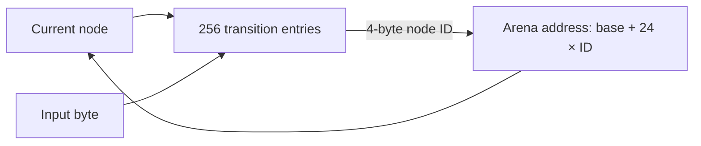

# Compact resident ClamAV engine

Update: [full-database measurements and implementation gates](demand-engine-implementation.md)
now supplement the earlier synthetic results below.

This fork implements the first resident-memory changes from the memory-reduction
proposal. It retains the signature database and the original exact verification
path in memory. It does not use demand paging of rules, probabilistic acceptance,
or repeated passes over input to save RAM.

Base: `dd3aa1907cf6e34286c86f8a24dd16e7a8d8810d` (upstream `main`). This is a
development build. A production database, production concurrency, reload overlap,
and representative adversarial traffic remain release acceptance requirements.
In particular, this fork does not claim a sub-200 MB whole-process memory ceiling
or a universal throughput guarantee.

## Implemented representation changes

| Component | Upstream representation | Fork representation |
|---|---|---|
| Ordinary logical match state | 64 counts, 64 first offsets, 64 last offsets per signature and live context | The validated number of subsignatures; same counters and offsets |
| Compatibility-sensitive logical state | 64 entries per array | Still 64: bytecode, YARA, macros, byte-compare owners, and missing/unusable metadata |
| AC transition row on 64-bit systems | 256 native pointers, 2,048 bytes | Optional 256 32-bit node IDs, 1,024 bytes |
| Node index | Native node ownership table | One construction/ownership table with two reserved entries; no duplicate scan index |
| Optional compiled nodes | Individually allocated nodes | One contiguous arena; 32-bit IDs compute a node address directly, and the construction table is discarded |
| AC pattern on LP64 | 136-byte common record | 96-byte record plus a 48-byte extension only when necessary |
| Trie construction FIFO | One linked heap record allocated/freed per visited node | One bounded temporary reference array reused for both passes and freed on every exit |

The formulas above describe requested payload, not RSS. For `L` ordinary
four-part signatures, the three scan-state arrays go from `768L` to `48L` bytes
per context, a 93.75% payload reduction. Pointer arrays, compatibility rows,
allocator overhead, parsers, archives, and the resident database remain additional
costs. For `R` owned transition rows, compact IDs save approximately `1024R`
bytes on LP64; leaf nodes that share a row must not be counted again.

The pattern split is also workload-dependent: requested record payload is
`96 + 48p` bytes per pattern when fraction `p` needs an extension, versus 136
bytes upstream. Before allocator overhead, it saves space when `p < 5/6`.
An extension-heavy custom database can make this component larger; the
benchmark and deployment gate must measure the complete engine.

The matcher continues to use its configured shallow anchor trie and its existing
full-pattern verifier. Candidate order, duplicate suppression, multipart matching,
first/last offsets, logical counts, and signature names use the original semantic
code. Pattern construction now transfers ownership only after successful insertion;
allocation failures clean up the extension and partial scan state. Node/table
arithmetic is checked before allocating or assigning a narrow ID.

The public `clamav.h` API is unchanged. The private matcher layout changes, so
rebuild private/internal consumers with this fork. The legacy
`cli_ac_initdata()` entry point retains 64-entry rows; production scan call sites
use `cli_ac_initdata_for_matcher()` after compilation.

## Build and tuning

Install the normal upstream ClamAV build dependencies, then:

```sh
cmake -S . -B build -G Ninja \
  -DCMAKE_BUILD_TYPE=Release \
  -DENABLE_MAN_PAGES=OFF \
  -DCVD_CERTS_DIRECTORY="$PWD/certs" \
  -DENABLE_COMPACT_LSIG_STATE=ON \
  -DENABLE_AC_NODE_IDS=ON
cmake --build build --parallel 2
ctest --test-dir build --output-on-failure
```

The certificate path above is for running directly from the source/build tree.
For an installed deployment, configure the installed certificate directory and
install the supplied ClamAV CA certificate there. Signature verification remains
enabled in both cases.

| CMake option | Default | Effect |
|---|---|---|
| `ENABLE_COMPACT_LSIG_STATE` | `ON` | Reduces ordinary logical tracking rows. `OFF` restores full-width rows for comparisons/diagnosis. |
| `ENABLE_AC_NODE_IDS` | `ON` | Uses four-byte transitions on 64-bit targets; the flat-node option selects how IDs locate nodes. `OFF` selects native pointer transitions. |
| `ENABLE_AC_FLAT_NODES` | `ON` | With IDs enabled, pack nodes into an arena to replace the dependent pointer lookup with address arithmetic. `OFF` retains the indirect-ID implementation for comparison. Ignored with native transitions. |
| `DISABLE_MPOOL` | Upstream default `0` | Use `1` for allocation-level sanitizer coverage; it is not a default memory optimization. |

These choices are made at build time; there is no new per-scan API or command-line
policy. All three transition layouts use the same patterns and verifier, with no new
scan-time I/O. On 32-bit targets, native pointer rows are selected automatically
because 32-bit IDs would provide no row-size reduction.

Select the transition policy using measurements on the deployment's hardware and
database. Smaller rows may improve cache behavior, but the ID lookup can cost
time. An average improvement on small files does not excuse a slowdown on a
different critical workload. Keep the native-pointer build available until the
compact-ID build meets that deployment's latency and throughput requirements.
Indirect IDs slowed the measured large-file workload. The contiguous-node
variant removed that regression in this experiment and is the development
default. The native-pointer alternative remains available for deployments with
different performance requirements; see the validation record for paired results.

The compile-time FIFO is at most `N * sizeof(cli_ac_transition_t)` bytes for `N`
non-root nodes. A deeply configured trie may have a smaller linked-queue frontier
than `N`; the new array is therefore not claimed to reduce temporary memory for
every trie shape. It is deliberately outside the long-lived memory pool and is
released after both traversals. Other pool-owned construction allocations have
not yet been moved to a separate arena.

The flat-node variant preserves all node IDs and match-list order. After trie
construction, it copies nodes once, remaps failure links, and releases the old
nodes and table. Allocation failure leaves the original nodes owned and safe to
free. The copy temporarily needs `24(N+2)` additional bytes on LP64. Memory-pool
holes left by the old nodes are not assumed to become immediately reclaimable
RSS. The arena stays resident and scanning performs no new file I/O.

The three transition layouts are mutually exclusive within a compiled engine:

| Layout | Entry size on LP64 | Finding the next node |
|---|---:|---|
| Native pointers | 8 bytes | Follow the stored address |
| Indirect IDs | 4 bytes | Read `node_table[id]`, then follow that address |
| Flat IDs | 4 bytes | Compute `arena_base + id * sizeof(node)` |

Think of nodes as numbered cards. Keeping the cards consecutively lets a short
card number locate a card directly. The patterns and matching rules on those
cards stay intact. On this LP64 build, each node occupies 24 bytes:



Logical scan state uses a separate saving: a four-part rule gets four tracking
slots instead of 64. Compatibility-sensitive rules keep all 64 slots. The slot
contents and sentinel values are unchanged.

## Regression and ABI checks

New C tests exercise compact row boundaries, independent contexts, all fallback
categories, overlapping scan windows, equal-pattern/suffix outputs, case folding,
wildcards, subsignature 63, offset sentinels, rejected node-index overflow, and
partial-state cleanup. Existing ClamAV integration tests remain in place.

The Rust binding generator now explicitly reads the same generated configuration
as the C compiler. Transition storage is opaque to Rust, so checked-in bindings
do not assume a particular C transition element width. To regenerate bindings, configure with `MAINTAINER_MODE=ON`
and provide libclang, bison, flex, and rustfmt. Then compare the affected record
sizes and offsets:

```sh
python3 tools/compact-memory/check_layout.py --build build \
  --include /usr/include/json-c --include /usr/include/libxml2
```

For a C address/undefined-behavior sanitizer build, use a separate build directory:

```sh
cmake -S . -B build-asan -G Ninja \
  -DCMAKE_BUILD_TYPE=RelWithDebInfo -DDISABLE_MPOOL=1 \
  -DENABLE_MAN_PAGES=OFF \
  -DCVD_CERTS_DIRECTORY="$PWD/certs" \
  '-DCMAKE_C_FLAGS=-fsanitize=address,undefined -fno-omit-frame-pointer' \
  '-DCMAKE_CXX_FLAGS=-fsanitize=address,undefined -fno-omit-frame-pointer'
cmake --build build-asan --parallel 2
ASAN_OPTIONS=detect_leaks=1:halt_on_error=1 \
UBSAN_OPTIONS=halt_on_error=1:print_stacktrace=1 \
ctest --test-dir build-asan --output-on-failure
```

The added GitHub Actions workflow covers default flat IDs, indirect IDs, native
transitions, legacy logical state, and a pool-disabled sanitizer configuration. Merely adding
that workflow is not evidence that it has run on GitHub.
The strict sanitizer job selects the matcher and regex suites: the full upstream suite
currently stops on a misaligned load in `matcher-hash.c`. The release jobs run
the full suite. Local validation and environment limits are recorded in
[validation results](compact-validation.md).

## Reproducible whole-engine comparison

Build the pinned baseline in a separate worktree using the same compiler, Rust
toolchain, optimization flags, dependencies, and options. The included Linux
benchmark uses only public libclamav APIs, so it can link against both builds:

```sh
git worktree add --detach ../clamav-baseline dd3aa1907cf6e34286c86f8a24dd16e7a8d8810d
# Configure and build ../clamav-baseline into ../build-baseline.
python3 tools/compact-memory/compare.py \
  --baseline-build ../build-baseline --fork-build build \
  --output ../compact-results --rows 20000 --rounds 30 --iterations 5
```

The driver produces a deterministic four-part logical database, clean inputs, and
a harmless detected-marker input. It randomizes baseline/fork order within each
pair and records raw load, compile, scan, resident, and peak-memory measurements,
database/input hashes, and build-cache hashes. It reports bootstrap intervals on
paired time ratios. Clean-file caching is disabled in both builds so repeated
scans do actual matching. All parsers and all-match mode are enabled. Treat the
results as a synthetic subsystem experiment, not a production signature/corpus
benchmark or a proof of all-input equivalence.

Whole-cgroup measurements still need to include file cache, kernel charges,
concurrent/nested scan contexts, old/new engines during reload, and build scratch.
Do not count a timeout, skipped parser, reduced concurrency, unavailable reload,
or changed error/verdict behavior as a successful memory optimization.

## Scope still requiring development

This branch does not yet implement immutable mapped snapshots, XOR-encoded
zero-sentinel offsets, compressed names, shared compiled logical expressions,
fully packed candidate records, or a separate arena for every builder allocation.
Those need independent semantic and performance validation. In particular, name
compression must preserve borrowed-string lifetimes, and candidate packing must
avoid retaining both old and new representations during compilation.

Before deployment, complete a production-database differential corpus, exact
alert/callback-order comparisons, sustained clamd reload/concurrency measurements,
32-bit and Windows/macOS validation, and bounded adversarial stress testing under
unchanged limits. Synthetic memory savings alone do not meet these gates.

## Provenance

The two record-layout commits retain Alexander Leidinger's authorship and include
cherry-pick references to upstream PR 1810:

- `9e5d37b5d5da5a6f6ace73052d003d53011ea1a7`: 32-bit AC transition indices.
- `2ad7b6513d2d1bd5c7941f6e0219554adc6bc202`: optional pattern extension.

The logical-row compatibility policy and its boundary test are adapted from
Ramez Rafla's PR 1836 commit
`4a6aa2b17a90a79ee5bbaa380c15ec0eb585ab82`. Expression compilation and candidate
packing from that patch are not included. This fork additionally unifies the node
tables, optionally packs nodes into a contiguous arena, uses a disposable compile
FIFO, adds build policies, hardens allocation
ownership/cleanup, updates bindings, and supplies differential checks and benchmarks.

Upstream's GPL-2.0 license and attribution remain in effect.
