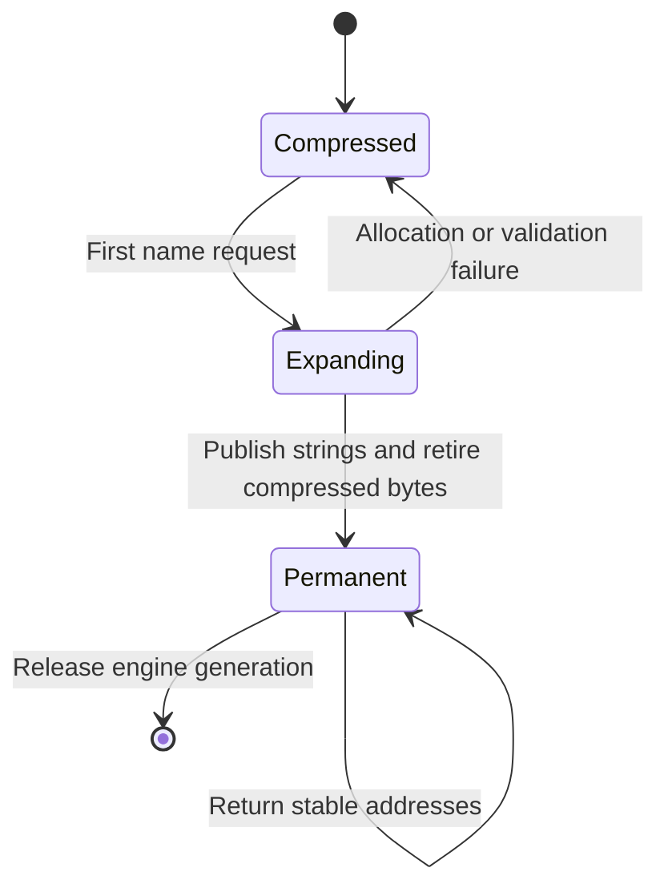

# Correlating the research with ClamAV's actual representation costs

> **Correction, 28 October 2026:** The old logical TDB exporter treated the range element count as a pair count, over-reading diagnostic data and overstating auxiliary bytes. Its logical-template counts, logical-layout totals and dependent aggregate estimates are superseded by [the corrected implementation report](logical-sharing-implementation.md). Production scanner range handling was unaffected. Earlier RSS observations and independently measured non-logical layouts are not invalidated by this diagnostic defect.

Follow-up: [exact tunable-profile prototypes](tunable-profile-prototypes.md)
implements and measures scalar columns, logical-template sharing and bounded
token-block caching under the clarified acceptance criteria. It supplies new
component measurements and negative latency evidence; the historical results
below remain unchanged.

27 October 2026. Engine examined: `8cc15ed675ac0d4883ac8dce168a019ffbc0189f`,
including the nonterminal-evidence repair. This revision adds diagnostic programs
and research evidence; it does not enable any new scanner representation.

Acceptance clarification, 27 October 2026: exact memory/time tradeoffs are
acceptable when the delivered design retains a selectable configuration that
can meet current performance characteristics. Correctness applies to every
supported profile; performance parity need not apply to every setting. The
[configuration contract below](#configuration-contract-after-the-clarification)
supersedes the earlier universal no-slowdown interpretation. Measurements and
the remaining whole-engine memory gap are unchanged.

## Findings

There are substantial opportunities in this implementation. The most useful
discoveries come from relaxing representation assumptions, then proving that
observable behavior is preserved. They do not require abandoning information
theory or accepting probabilistic detection. Nor does this review establish that
the researchers overlooked their own problem's solution: several apparently new
ideas are already known, and their application constraints differ from ClamAV's.

Four investigations produced new executable evidence:

| Opportunity | Concrete result | Decision under the clarified configuration requirement |
| --- | --- | --- |
| Group similar transition rows; replace default-cycle walking with word rank | Routing layout 75.164 → **10.631 MiB**; every real state/byte transition agrees | Eligible for an optional compact profile after integration qualification; the measured 3.34–3.53× repetitive-input slowdown excludes it from a performance-parity claim |
| Expand compressed name blocks once, then retire their compressed copies | Names 83.133 → **29.820 MiB cold**, 91.591 MiB if every block expands, including directory | Corrects the earlier dual-copy worst case; native integration and first-alert latency remain untested |
| Make the logical “unset” offset encode to zero | Fresh PE offset arrays: observed median RSS growth **10,888 → 56 KiB** with no writes | Exact, promising per-scan optimization; fully touched arrays save nothing; bytecode/YARA access must be adapted |
| Compress identical consecutive evidence metadata without deleting history | One million identical 24-byte metadata entries can occupy one 32-byte run | Exact model passes; plain RLE expands distinct entries, so a bounded literal fallback is essential |

These numbers concern different accounting boundaries. They are not additive
whole-engine RSS savings. “Cold” means no name blocks have been requested, not a
measured WordPress average. All MiB in this report use 1,048,576 bytes.

## Method and source boundary

The theoretical question was: which stored information is redundant **given the
other information and the observable API**? The practical questions were: can we
remove it with bounded decoding work, preserve ordered effects, and avoid moving
cost into allocations, file cache, updates, or attacker-controlled slow paths?

The experiments use the same verified database snapshot as the earlier work:
main 63, daily 28164, bytecode 339, containing 3,628,192 loaded signatures. This
is not a claim that it is today's newest database. The exported census contains
3,547,706 distinct names and 3,213,522 hash records. Source databases and raw
signature exports are not redistributed in this package.

Primary research retrieved for this review includes work through 22 October
2026. A preprint's date is not evidence that it is peer reviewed or appropriate
for production. The principal correlations are:

| Research and status | Relevant result | What transfers, and what does not |
| --- | --- | --- |
| [Bille et al., DFA compression hardness, 22 October 2026 preprint](https://arxiv.org/html/2610.31273v1) | Optimal D²FA compression is NP-hard; the best forest construction has a tight 3/2 approximation ratio | Question the forest restriction, but the theorem counts transitions, not bytes or scanner memory |
| [Bille, Gørtz, Pedersen, SOFSEM 2025](https://www2.compute.dtu.dk/~phbi/files/publications/2025fpcodfaC.pdf) | Scalable similarity discovery and practical D²FA construction | Useful builder ideas; this paper already states the condition for valid default cycles |
| [Kurpicz et al., ESA 2026](https://doi.org/10.4230/LIPIcs.ESA.2026.8) | Practical constant-time rank/select with very low redundancy | Revisit large rank directories; a single 64-bit bitmap does not need their general structure |
| [Groot Koerkamp, BiRank/QuadRank, SEA 2026](https://arxiv.org/abs/2602.04103v2) | BiRank combines 3.28% redundancy, inlined counters and batch prefetch | Particularly relevant when short-window lookups are independent; published speedups do not transfer automatically |
| [Hermann et al., Learned Static Functions, PVLDB 2026](https://arxiv.org/html/2510.27588v2) | Exact value retrieval uses key/value correlations and residual codes | Exploit conditional metadata entropy; arbitrary answers for absent keys make this insufficient for exact membership |
| [Blelloch et al., FOCS 2026](https://arxiv.org/abs/2608.06066) | Near-entropy dynamic arrays with constant-time operations in their theoretical model | A reason to investigate sparse/default-heavy state; not a measured native ClamAV implementation |
| [Varki, Gagie, Boucher, CPM 2026](https://doi.org/10.4230/LIPIcs.CPM.2026.5) | RLZ-assisted RePair reduces compressor construction memory | Relevant to repetitive rule/program compilation; its reported runtime increase conflicts with a free-speedup interpretation |

The preceding [frontier report](regression-fix-and-memory-frontier.md) covers
double-array AC, succinct matching, PHastR/PtrHash, OptFSST, filters and other
2026 compression work. Their limitations remain applicable. This review changes
the ownership analysis for compressed names and adds the experiments below.

## 1. Valid cycles can be decoded without walking them

### The overlooked assumption

The current compact AC implementation stores completed 256-entry transition
rows, using 32-bit destination IDs. Many rows share large portions of their
contents. A traditional delayed DFA replaces common entries with defaults, but
following defaults adds dependent loads. Avoiding cycles simplifies construction
and termination; it is not necessary for semantic correctness.

The October paper formalizes the cost of the forest restriction. This is not
evidence that earlier researchers were unaware of cycles: the 2025 paper already
requires an explicit exit for each character on any default cycle. Column-wise
run compression of DFA tables also predates this work; see the primary disclosure
[CA2629618A1](https://patents.google.com/patent/CA2629618A1/en). No novelty or patent
clearance claim is made here.

The synthesis tested here is narrower: **put similar rows in small cycles, and
compute the endpoint of a default traversal directly with one word-rank query**.

### Construction and correctness

Let a group contain `k ≤ 64` rows, indexed cyclically. For each character `c`, mark
row `i` when its destination differs from row `i+1`:

\[
B_c[i]=[T_i[c]\ne T_{(i+1)\bmod k}[c]].
\]

If the column is constant, mark row zero instead. Store destinations at marked
rows, in row order, in `D_c`. With rank counting marks **strictly before** `i`:

\[
T_i[c]=D_c[\operatorname{rank}_1(B_c,i)\bmod \operatorname{popcount}(B_c)].
\]

Why: the first mark at or after `i`, wrapping if necessary, ends a run of equal
destinations. Its ordinal is exactly the rank in the formula. The constant-column
case has one marked owner. There is no loop over default transitions and no
select query. The code implements wrap with a comparison, not integer modulo.

For one example column:

| Row | Original destination | Boundary bit | Marks before row | Returned destination |
| ---: | --- | ---: | ---: | --- |
| 0 | A | 0 | 0 | A |
| 1 | A | 1 | 0 | A |
| 2 | B | 0 | 1 | B |
| 3 | B | 1 | 1 | B |
| 4 | A | 0 | 2, wrapped to 0 | A |

Only physical row order changes. Original state IDs, candidate lists and their
traversal order remain the oracle. Equality of every state/byte transition implies
equality of the entire state sequence by induction, for arbitrary-length input.
This is stronger than merely preserving a final “malicious” bit and avoids a
short-anchor assumption. It does not by itself validate integration code.

### What was built and measured

[`probe_transition_factoring.c`](../tools/compact-memory/probe_transition_factoring.c)
constructs actual packed masks (16/32/64 bits), 257 uint16 offsets per group and
uint32 destinations. A group uses raw rows if those are smaller. The byte count
includes group descriptors and a four-byte state-to-row map, but not allocator
rounding or compiler scratch. The old engine remains resident as the oracle.

The program verifies **142,322,432 real state/byte pairs per configuration** over
12 active roots, for six cyclic configurations. State zero is an unused sentinel.
All comparisons passed. It also tests four exact microblock-interning layouts.
Two inactive root rows are retained in the aggregate totals.

| Alternative routing representation | MiB | Reduction versus current rows | Performance evidence |
| --- | ---: | ---: | --- |
| Current completed uint32 rows | 75.164 | — | Reference |
| Previous short-window/dense hybrid | 21.282 | 71.69% | Earlier isolated tests only; requires the bounded-history condition |
| Interned 16-entry microblocks plus indexes | 19.078 | 74.62% | Exact row reconstruction checked; scan lookup time not measured |
| Lexically ordered cyclic groups of 64 | 10.631 | 85.86% | Exact transitions; fails repetitive-input timing gate |

Ordering matters more than the clever decoder. For the PE root, 64-row groups
in original order take **56.241 MiB**, exceeding its 54.435 MiB dense rows after
metadata. Lexicographic grouping takes **8.693 MiB**. This supports measuring
cross-row correlation before optimizing individual fields. A whole-root dense
fallback avoids selecting a larger serialized layout for an unsuitable database.

PE timing used three 1 MiB streams, ten alternating-order pairs, CPU affinity 2,
GCC 13.3 `-O3 -mpopcnt`, on a shared Xeon Platinum 8370C host. No other local
heavy experiment ran concurrently. Ratios are geometric means of paired times;
intervals bootstrap those ten pairs, not hardware/workload generalization.

| Input | Cyclic time / dense time | Bootstrap 95% interval |
| --- | ---: | --- |
| Seeded random bytes | 0.684 | 0.593–0.757 |
| All zero bytes | **3.529** | 3.036–4.147 |
| Repeated sequence 0 through 255 | **3.344** | 2.964–3.777 |

Constant word-operation count therefore does **not** mean no performance loss.
Repetitive input gives the original representation extremely cheap hot lookups.
The extra dependent accesses outweigh compression. An attacker can supply such
input. This version fails the performance-parity gate, but that no longer rejects
it as an optional compact configuration. It still needs integrated correctness,
resource-bound and timing qualification. Keep the guarded default until then.

A small dense hot-row front end or bounded decoded-row cache is a research
candidate, not a compensating control already demonstrated. It must survive
crafted cache thrashing and cycling among nonresident rows. Counting both layouts
must not erase the saving. Benchmark-specific special cases are not sufficient.

## 2. Stable names do not require permanent duplicate representations

### Correction to the earlier conclusion

The previous report correctly rejected an evicting cache of returned C strings.
It then calculated a 127.898 MiB worst case for retaining both raw names and the
OptFSST representation. That is the bound for **that ownership policy**, not a
fundamental API lower bound.

Instead, give each independent block one of two lifetime states:

Internal records carry name IDs. On the first request for any name in a block,
decode into its final allocation, publish it safely, and free the compressed
payload once readers no longer need it. Published strings never move until the
engine generation is released. Raw fallback blocks are permanent from the start.
This preserves the required string contents and lifetime; it must not use the new
ID or allocation order to reorder candidates.

For directory size `D`, original block sizes `R_b`, compressed sizes `C_b ≤ R_b`
and expanded blocks `E`:

\[
M(E)=D+\sum_{b\notin E}C_b+\sum_{b\in E}R_b
\le D+\sum_b R_b.
\]

With one direct-to-final expansion at a time, the temporary extra compressed
copy gives peak `≤ D + ΣR_b + max(C_b)`. With at most `P` simultaneous expansions,
use `P·max(C_b)`, plus bounded decoder/synchronization storage. Deferred reclamation
must also be bounded; an indefinitely retained compressed reader invalidates
this peak argument. Do not stop checking or turn allocation failure into “clean”.

### Full-corpus encoding and pointer experiment

[`probe_monotone_names.py`](../tools/compact-memory/probe_monotone_names.py) front
codes independent sorted blocks with exact raw fallback. Every name is decoded
and compared for every tested block size. It also keeps 10,000 actual ctypes C
addresses and verifies them again after other blocks expand. All passed.
The layout budgets 32 bytes per block and two bytes per name for offsets.
It uses the same seeded uniform query trace for all three sizes. These are
accounted layout bytes, not Python RSS or a representative workload.

| Names per block | Cold layout MiB | Directory MiB | Fully expanded MiB | Maximum compressed block bytes |
| ---: | ---: | ---: | ---: | ---: |
| 16 | 38.319 | 13.533 | 96.666 | 592 |
| 64 | **29.820** | **8.458** | **91.591** | **1,812** |
| 256 | 27.695 | 7.190 | 90.323 | 5,372 |

For 64-name blocks the cold saving against the 83.133 MiB raw payload is 53.313
MiB. Fully expanded names alone cost 8.458 MiB more than that payload because
the directory remains. Larger blocks reduce initial metadata but expand more
unrequested names per first access. The query-trace checkpoints in the JSON
quantify this tuning opportunity without calling it an application average.

There is a useful **joint** layout calculation: the current hash matchers have
3,213,522 eight-byte name links. Four-byte global IDs save **12.259 MiB**, enough
to finance the 64-name-block directory. Raw names plus these links occupy
107.650 MiB; the proposed pair takes **42.078 MiB cold** or **103.850 MiB fully
expanded**. Thus the joint representation saves 65.572 MiB cold and 3.800 MiB at
full expansion, before allocator/locking costs. This ID saving must not also be
counted in another record-packing budget.

Native implementation still needs safe publication, error propagation, raw/wide
escapes for oversized names/blocks, bounded construction memory, lifetime tests
under reload, and latency measurements. The Python prototype retains originals
as an oracle and makes a temporary decode buffer; it is not a native peak-memory
measurement. The tighter formula describes direct-to-final decoding. A first
alert incurs block decoding, so no unchanged alert latency is claimed.

## 3. Change the encoding of “unset”, not the logical state

`ac_initdata` in
[`matcher-ac.c`](../libclamav/matcher-ac.c) allocates logical-subsig first/last
offset arrays and fills every entry with `CLI_OFF_NONE`, which is **0xfffffffe**.
(`CLI_OFF_ANY` is 0xffffffff.) Counts already have a zero default.

Use the bijection `encode(x) = x XOR CLI_OFF_NONE`. Unset now has bit pattern zero;
all 32-bit values, including both sentinels and legitimate boundary values,
round-trip exactly. Fresh zero-backed anonymous memory can represent untouched
entries without private physical data pages. Unlike a hash table or sparse map,
indexing remains deterministic and direct. A decode adds one XOR.

This connects default-heavy dynamic arrays to the operating system's zero-page
mechanism. It is an elementary encoding optimization, not an implementation of
the FOCS theorem. It avoids writing data that contain no new information.

The PE root has 1,386,025 logical slots. Its first and last offset payload totals
`2 × 1,386,025 × 4 = 11,088,200 bytes`, or **10.575 MiB per PE scan context**.
[`probe_zero_default.c`](../tools/compact-memory/probe_zero_default.c) uses fresh
anonymous mappings, verifies every slot before and after writes, and exercises
sentinel edge values. Three fresh processes per condition produced:

| Fraction of pages written | Original median RSS increase KiB | Zero-default median RSS increase KiB |
| ---: | ---: | ---: |
| 0% | 10,888 | 56 |
| 1% | 10,888 | 160 |
| 10% | 10,888 | 1,136 |
| 100% | 10,888 | 10,888 |

RSS includes small process noise; it is not a cgroup accounting of page tables.
The source deliberately reads all slots, so this is not merely avoiding reads.
Once every page is written, the saving vanishes. Anonymous virtual reservation
and page-table costs remain. Reused malloc pages need not behave like fresh
mappings; resetting/recycling contexts needs separate measurement.

Changing initialization alone is incorrect. All readers/writers must use the
encoding, including byte comparisons, YARA, and bytecode hooks that currently
consume raw offset arrays. A decoded bounded compatibility view or explicit
accessors are required. Relevant files are `matcher-ac.c`, `matcher-byte-comp.c`,
`yara_exec.c`, `matcher.c` and `bytecode.c`. Fresh-page faults and access costs
also require an integrated benchmark. Ordinary PHP scans do not necessarily
allocate the large PE context, so 10.575 MiB is not a WordPress-average saving.

## 4. Preserve evidence history while compressing its repetition

[`libclamav_rust/src/evidence.rs`](../libclamav_rust/src/evidence.rs) stores an
ordered map from names to vectors of `(original name pointer, depth, object ID)`.
Each metadata item occupies 24 bytes on this 64-bit target. Inspection of getters
alone suggests storing just the latest item. That is wrong: `remove_indicator`
pops one occurrence and can expose an older item. A sequence `A, B, pop` must
return `A`, not nothing or `B`.

Consecutive identical triples can instead become `(triple, count)`. Push increments
the count; pop decrements it and removes the run at zero. Child merge adds depth
one, or adds zero for normalized content. It preserves order and multiplicity.
Equality includes the original pointer and object ID, not just the displayed
name. Name-map insertion and removal order remain unchanged.

[`probe_evidence_runs.py`](../tools/compact-memory/probe_evidence_runs.py) compares
the complete ordered stacks after each of 20,000 seeded operations, including
push, pop, clone and child merge. All passed. It explicitly verifies the rollback
counterexample and a million-entry repeated run. This is a representation model;
it does not validate FFI errors, empty-child rejection, integer overflow or Rust
allocation behavior.

For one million identical entries, metadata payload goes from 24,000,000 bytes
to one 32-byte run. But all-distinct runs cost **33.3% more** than original entries.
Use a literal/run hybrid or a budgeted representation fallback, and test its
conversion cost. An attacker can alternate metadata to defeat plain RLE.

Required JSON occurrences and callbacks still have to be emitted. The Rust
compression does not eliminate these outputs or change severity. Explicitly
producing `z` output records requires at least proportional output work. Reusing
an existing name key without allocating `name.to_string()` for every repeat is
an additional source-level allocation opportunity, not a measured speedup here.

## 5. Opportunities beyond the current design assumptions

These are falsifiable research hypotheses, not completed optimizations.

**Compute observable actions, not unnecessarily detailed states.** For a proven
bounded-history AC target, the short input window already determines the next
state. If that state is used only to select ordered candidate/failure lists, a
window-to-output-descriptor function may avoid storing distinguishable states
that produce the same action sequence. This is an observational quotient, not
ordinary Boolean DFA minimization. Prove the history bound from the compiled
trie; preserve part-number gates, multipart and logical accounting, failure-list
control, callbacks and early exits. Keep a general fallback for deeper custom
tries. Falsification test: differential *ordered effect traces* over all short
windows and adversarial longer streams. No byte saving is booked yet.

**Exploit independent lookups without reordering their effects.** Short-window
routing permits lookahead/prefetch because window `i+1` does not depend on the
decoded state at `i`. The previous prototype stores a 32-bit rank prefix for
each 64-bit word: 50% overhead on each 2 MiB bitmap. A simple 512-bit scheme using
a 32-bit base and seven packed nine-bit counts needs 12 bytes per 64 bitmap
bytes: 18.75% overhead. Across the four selected directory roots, that projects
to **2.5 MiB less**. BiRank's 3.28% overhead projects to about **3.74 MiB less**,
subject to concrete padding/layout costs. These are alternatives, not additive
savings. Prefetch may overlap latency, but replay candidate actions in input
order and stop at the same terminal event. Falsification test: both throughput
and low-entropy/adversarial latency, with all boundary effects traced.

**Encode metadata conditionally, not field by field.** Here 99.29% of AC patterns
have ANY offsets and 97.25% are logical subsignatures. Common combinations can
select a compact record template; exceptions retain complete exact fields. The
proper information quantity is `H(fields | template, context)`, with model and
indexes included, not the sum of separately encoded field widths. Learned static
functions reinforce this principle; deterministic templates may capture most
of the benefit with simpler access. The digest itself is not expected to predict
a malware label usefully; that is an assumption to measure, not a theorem.
Falsification test: actual serialized bytes including escapes and association
maps, then candidate-heavy lookup latency. Existing record-packing budgets
already include part of this opportunity and cannot be added twice.

**Share verifier subprograms, but preserve their ordered effects.** Exact token
deduplication has already demonstrated 46.210 MiB of representation savings
before integration overhead. ClamAV's `patt_cmp_fn`/`next_same` machinery already
shares some equivalent-pattern verification; “verify duplicates once” is not a
new finding. Additional common subexpressions may form a DAG across partially
shared verifier or logical programs. Counted matches, offsets and callbacks
mean Boolean equivalence is insufficient. RLZ/RePair suggests compiler options,
not a proven execution format. Reject candidates that create deep dependent
decoding, exponential compilation, or reordered side effects. First measure
common subprograms and bound DAG depth before designing a new interpreter.

**Compress changes between engine generations without destabilizing everything.**
A new database has conditional information given the old one. Stable independently
compiled chunks can share unchanged bytes during reload. Global name numbering
by sorted position or retraining a global codec can change many blocks after a
small edit; local IDs and local dictionaries may retain more sharing despite
slightly worse single-generation compression. Falsification test: consecutive
real updates, charged resident/file-cache memory for both generations, and
forced all-changed updates. Worst-case sharing is zero. Moving update memory to
another process on the same host does not make it disappear.

These hypotheses deliberately cross automata, information theory, virtual memory,
ownership and database execution. They do not assume that a new computing model
can bypass required information, output or memory-access costs.

## 6. What the combined accounting says about the quarter-memory target

The most optimized historical setting was 808.168 MiB; its quarter is 202.042
MiB. The guarded repaired build measured about 823.947 MiB. New component layouts
are not a new whole-scanner measurement.

An instructive calculation combines the 64-name-block scheme and hash name IDs,
full digest keys, previously deduplicated/byte-specialized tokens, and the new
cyclic route. These are disjoint payload categories in this calculation:

| Chosen components | Cold names MiB | Fully expanded names MiB |
| --- | ---: | ---: |
| Names plus hash name IDs | 42.078 | 103.850 |
| Full digest keys | 49.038 | 49.038 |
| Token encoding with its two indexes | 39.967 | 39.967 |
| Cyclic routing, including its lookup metadata | 10.631 | 10.631 |
| **Subtotal** | **141.716** | **203.487** |

This excludes pattern records, candidate lists, logical programs, node/output
metadata, other matchers, parser state, allocator costs and update overlap. Even
this subtotal exceeds 202.042 MiB when all name blocks expand. Its cyclic route
can now be considered for a slower exact profile. The memory arithmetic still
**rules out this exact
combination as the claimed worst-case solution**, not every possible ClamAV
representation. Cold savings are useful but cannot honestly certify the target.

A tiny perfect-hash index does not remove exact digest membership storage.
There may be some succinct-set saving: for `n` distinct uniformly distributed
128-bit keys, `log2 binomial(2^128,n)` is about
`n·(128 − log2(n) + log2(e))` bits. At 3.214 million keys the theoretical reduction
versus raw 128-bit values is roughly 7.7 MiB, before indexes and value associations.
This is an idealized distinct-set calculation; actual matchers use multiple hash
sizes, file-size/type partitions, duplicates and semantics. It does not justify
dropping full-key verification or claiming an attainable 7.7 MiB engine saving.

The practical priority remains compact records, exact shared tokens and ordered
candidate storage; then name ownership/IDs and zero-default scan state. Qualify
the short-window route with a smaller rank directory before adopting the cyclic
alternative in the performance profile. The clarified requirement makes the
cyclic format eligible for an explicit compact profile, subject to qualification
of its measured weakness and resource bounds. Evidence compression
addresses per-scan attack amplification, not most idle database RAM.

Acceptance requires the repaired detection semantics, signature families and
resource policies to remain intact. Differential tests must compare ordered
names, severity, logical counts, callbacks, stop/trust/error behavior and retained
pointers—not just a virus-found flag. Memory qualification must include cold and
warm scans, name-exposure floods, distinct-evidence floods, parser expansion and
reload overlap. Performance must include repetitive and candidate-heavy inputs.
The performance profile cannot use average clean throughput to conceal such
regressions; slower profiles must disclose and bound their additional costs.

No SiteGround allowance, WordPress workload average or production latency is
verified here. File-backed pages charged to the hosting limit count. None of
these experiments changes a hosting installation.

## Configuration contract after the clarification

The design will expose exact representations with different memory/time costs.
These are proposed profiles, not configuration switches already implemented:

| Profile | Purpose | Requirement |
| --- | --- | --- |
| Performance | Retain current performance characteristics, spending memory where necessary | Preserve a selectable path equivalent to the repaired optimized baseline; measure dispatch, lookup, scan, load and update overhead after integration |
| Balanced | Select validated component tradeoffs | Publish measured memory, throughput and tail latency; preserve the same result semantics |
| Compact | Minimize memory while allowing additional computation or explicit I/O | Preserve exact coverage and ordered effects; document cold/warm and adversarial costs and bounded failure behavior |

Potential controls include routing representation per root (dense, short-window
where applicable, or cyclic), name-block size and eager versus one-way lazy
expansion, raw versus encoded metadata, and bounded prefetch budgets. Select
representations during build/load wherever possible. Do not allocate both full
layouts in a compact engine merely to leave the fast option available: a later
configuration change may require a rebuild/reload, whose peak must be counted.

Every supported profile must retain signatures, exact key verification, ordered
candidate/evidence behavior, severity, logical accounting, callbacks, returned
name lifetimes, and stop/trust/error semantics. A memory-saving setting cannot
drop rules, shorten verification, collapse observable history, reorder threats,
or turn an incomplete scan into a clean result.

Slower execution can reach a fixed wall-clock scan limit sooner. Therefore,
lossless data representation alone does not establish operational equivalence:
compare completion/timeout/limit outcomes as well as completed-scan verdicts.
Do not silently change scan limits to make a profile pass. A setting that skips
work or produces additional incomplete scans under the promised operating
conditions cannot be advertised as fully equivalent. Explicit time-budget tuning
and its effect on availability must be documented separately from representation
correctness. Attacker-controlled decode, cache-miss and allocation paths require
bounded work and memory in every supported profile.

Qualification has two separate results: (1) at least one selectable exact
configuration meets the baseline's measured performance characteristics, and
(2) a compact configuration meets its stated memory/time envelope. The same
configuration need not attain both extrema. Report the memory/time pairs
together; never combine the compact profile's memory with the performance
profile's speed into one claimed deployment result. The quarter-memory target
remains a goal for an actual complete configuration, not a sum of best figures
from incompatible representations. No acceptable compact-profile slowdown or
SiteGround time budget has yet been measured or specified.

The existing dense route provides the starting point for the performance
configuration; retaining its code is not sufficient proof that a redesigned
engine meets that configuration's performance gate. Common indirections,
allocations, decoding and updates must also be measured. The historical
performance results are evidence about that baseline, not newly integrated
profiles. This clarification changes eligibility and acceptance criteria; it
does not qualify or enable the diagnostic implementations.

## Reproducibility and limits

The five new programs are in `tools/compact-memory/`. Raw observations, aggregate
calculations, hashes and commands are in [correlation-results](correlation-results/README.md).
The engine and earlier regression tests were not changed or rerun for these
standalone representation experiments. Their previous successful results remain
documented separately; they do not qualify the proposed representations.

No result here proves universal speed parity. The useful progress is a sharper
set of exact constructions, actual compression measurements, explicit negative
performance evidence, and an accounting counterexample that prevents a premature
claim of the fourfold target.
