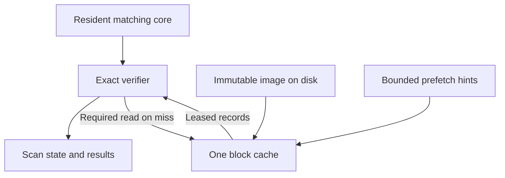

# ClamAV demand-loaded engine implementation plan

October 26, 2026. Original planning document.

Implementation update: [the full-database G0 check failed](demand-engine-implementation.md).
The first allocation replacements and census tooling are implemented; the paging
architecture below is not implemented or approved for deployment.

## ClamAV demand-loaded engine

Implementation plan | October 26, 2026 | Design, not implemented

Build one immutable compiled database with a resident matching core and demand-loaded hash and pattern blocks. Use one bounded cache and deterministic prefetch hints. Preserve the existing exact verification paths, supported signatures, signature updates, and scan outcomes.

### Decision and feasibility boundary

Proceed through measurement gates before committing to a SiteGround deployment. The 200 MB objective is a measured whole-scanner target, including update-time processes and relevant filesystem-cache charges; it is not established by setting a 48 MB cache. SiteGround publishes 768 MB per process, which is a separate hosting gate rather than an account-wide memory allocation. [6]

The target workflow is Legal Redress uploads through Forminator: up to five PDF/JPEG/PNG files of 5 MB each. Model one scanner processing one file at a time. Scanner placement, host permission for the executable or daemon, actual concurrency, WordPress RSS, and storage latency remain deployment inputs. Do not change the site while implementing this plan.

### Scope commitments

- No signature subset, parser removal, weakened update validation, earlier timeout, or incomplete scan presented as clean.
- Prediction only schedules reads. The exact matcher always loads a required missing block or returns a scan error.
- Do not claim unchanged adversarial performance from bounded memory. A cache-thrashing regression fails the performance gate even if the result is correct.
- Additional optimizations must remove or replace existing ownership, pointers, allocations, or initialization. New learned indexes, compressed-block codecs, or independent caches are excluded.
- Keep the current compact resident build as the comparison and rollback implementation until the new path passes all gates.

### Implementation sequence

Measure real databases -> replace redundant bookkeeping -> define the immutable format -> implement the reader/cache -> page hash records -> page eligible candidate/pattern records -> add prefetch -> implement bounded compilation and updates -> integrate and qualify the deployment.

### Starting evidence

Starting fork: d352706f40d1cb5a3213b8f8fc69c6030582bdd7, based on upstream dd3aa1907cf6e34286c86f8a24dd16e7a8d8810d. Its 20,000-rule synthetic experiment measured about 31% lower compiled RSS; no full official database, production daemon reload, or SiteGround deployment was measured. Do not extrapolate that percentage into this design. [1]

## 1  Establish the memory and access baseline

First deliverable: a reproducible feasibility report

Obtain the full official database through a supported update path and preserve its version, manifest hashes, configuration, and verification results. The earlier environment returned HTTP 403; if that persists, use an authorized test host or supplied database copy rather than disabling verification. Test a representative custom-signature corpus separately.

| Measurement | Required breakdown |
| --- | --- |
| Resident engine | Generic/type transitions, nodes, candidate chains, patterns/extensions, digests, bucket directories, names, logical expressions, regex/bytecode, other subsystems. |
| Allocation lifecycle | Requested bytes, allocator-held bytes, construction scratch, discarded growth buffers, and post-compile RSS/PSS. |
| Working set | Logical accesses to prospective 4/16/64 KiB blocks, separating hot routing from verification payload. Record order and reuse distance. |
| Lifecycle peaks | Cold load, warm scans, nested scans, signature validation, compilation, concurrent reload, retired-generation cleanup. |
| Host resources | Process RSS/PSS, cgroup memory and file-cache charges where available, CPU, bytes read, read latency, temporary disk and queue delay. |

### Instrumentation design

Add a build-only trace mode around logical record accesses, not signal handlers or one event per input byte. Map record IDs to prospective disk blocks and stream compact access records through a bounded ring. Include every lookup and pin lifetime needed for cache simulation; record dropped events and reject incomplete traces. Measure performance with tracing disabled.

Replay traces using the proposed CLOCK cache, demand priority, and prefetch budget. Compare block sizes, cache sizes, miss ratios, bytes fetched unnecessarily, and maximum simultaneously pinned blocks. Reuse distance alone is insufficient: include large records, interleaving, generations, and actual host I/O measurements. Trace simulation predicts candidates for implementation; it does not prove timing.

### Feasibility gate G0

- Compute the irreducible resident floor: routing tables + name arena + compatibility-sensitive structures + code/runtime + minimum scan workspace.
- If that floor exceeds 200 MB, declare that the current architecture misses the target. Do not hide the excess in file cache or omit a signature class.
- Identify at least one cache/block configuration with promising ordinary and adversarial working sets before building the paging path.
- Publish absolute component counts and lifetime peaks. Synthetic ratios and historical documentation are not substitutes.

## 2  Define the storage and ownership boundary

One exact matcher and one canonical compiled record format

| Lifetime / placement | Contents |
| --- | --- |
| Resident, immutable | Generic and type routing transitions, routing IDs, small directories, logical-rule descriptors, interned stable names, and non-pageable compatibility data. |
| Cached, immutable | Full hash records and name IDs; candidate chains and eligible full-pattern bundles. No raw pointers or scan-mutated fields. |
| Per-scan, private | Counts, first/last offsets, parser state, match results, cache leases and bounded prefetch requests. Never written into the compiled image. |
| Builder-only | Parsing scratch, temporary indexes, sorting workspace, symbol-resolution tables, node construction records. Destroy or unmap after publishing. |

### Compatibility decisions

Preserve the public scan APIs and their result/name lifetimes. All externally borrowed signature-name strings live in one immutable engine-owned arena. Exact interning removes duplicates. Do not return a pointer into an evictable block or introduce an unbounded cache of names encountered over time.

Keep regex runtime objects, bytecode runtime/JIT objects, YARA compatibility state, and pattern forms requiring persistent native pointers resident initially. An oversized or unsupported cold-record representation stays on the existing resident verification path; it is never skipped. Report every such byte in the resident floor and require the deployment budget to pass with these fallbacks.

Within each candidate chain retain the existing head order, next links, next_same links, part numbering, offsets and duplicate behavior. Store IDs in the compiled representation; the matcher uses short-lived read-only views. Do not replace matching semantics with a new filter or reorder detection callbacks to improve disk locality.

### Maintainability boundary

The necessary new subsystem is the store reader/cache. Additional layout work replaces old tables and ownership lists. Preserve the current resident backend during migration, then share verifier accessors and builders so the two modes do not acquire separate semantic implementations. Do not expand the existing native/indirect/flat transition experiment into a Cartesian product of cache algorithms.

## 3  Specify the immutable image

Versioned, local compiled artifact derived from verified databases

| Region | Contract |
| --- | --- |
| Header | Magic, format revision, exact length, build/ABI and feature fingerprint, configuration fingerprint, complete database-manifest digest, generation identity and directory bounds. |
| Directory | Section kind, target, hash purpose/algorithm where relevant, byte range, record count, record width/layout, block range, and hot/cold classification. |
| Resident sections | Validated serialized records reconstructed into current hot runtime layouts. Native addresses, mutexes and compiled machine-code pointers are never serialized. |
| Cold sections | Fixed-size uncompressed blocks. Start experiments at 16 KiB; select the shipping size from 4/16/64 KiB measurements. Keep record boundaries and necessary small bundles within blocks. |
| Integrity table | SHA-256 per cold block, tied to the validated manifest and generation. At 16 KiB the digest payload is 32/16384 = 0.195% of cold data, before other metadata. |

### Representation and validation

For runtime objects that cannot be serialized, retain canonical constructor inputs in the image and rebuild those objects with the existing constructors during attach. Count their initialization time and peak RAM. Never dump native PCRE/JIT/Rust object memory or invoke the full original loader behind an apparently lightweight attach.

- Use fixed-width encoded fields, checked 64-bit file offsets, and checked section-relative IDs. Define byte order explicitly. Never serialize sizeof(native_struct) bytes as the disk ABI.
- Preserve the hash comparator and ordering required by the existing matcher; bind an image to the relevant runtime fingerprint. Do not silently change duplicate-hash name selection.
- Validate multiplication/addition before allocation, ranges against actual file length, object types and link bounds, non-overlap rules, reserved flags, root counts and block-digest counts.
- Detect candidate-link cycles or impossible chain lengths during compilation/validation, before scanning untrusted input.
- Reject incompatible, truncated, stale-config or corrupt images before activation. A block checksum failure becomes an error, never CL_CLEAN.

### Trust and publication

Official signature authenticity continues to come from the existing verified database path. A locally produced compiled image is not vendor-signed. Build it in a private directory, bind it to the validated source manifest, validate the emitted image, fsync it, and atomically publish its manifest. Block checksums detect corruption; they are not authentication against an attacker able to replace both the image and its trusted manifest.

Open and retain a descriptor for a published generation. Never rewrite or truncate that inode. Old scans retain their generation until completion; cleanup deletes only unreferenced retired generations. Keep the last valid generation and enough disk capacity for current, staging, retired and sorting files.

## 4  Implement one bounded reader and cache

Explicit reads preserve ordinary error reporting

Use explicit offset-based reads into a fixed block arena for cold payloads, rather than relying on mmap residency as a hard memory limit. This makes short reads and I/O failures normal error paths. The kernel can still cache these reads, so account for that memory separately. Do not add O_DIRECT, userfaultfd, custom signal handlers, or a second decoded-record cache in the initial design. [5]

| Operation | Required behavior |
| --- | --- |
| acquire(generation, block) | Return a read-only leased view, or wait for the single in-flight load of the same key. Verify the block before exposing it. |
| release(view) | Drop the pin. No raw block pointer may survive release, a callback, or parser recursion. Store IDs in longer-lived state. |
| prefetch(keys) | Best effort, bounded and deduplicated. Use cache slots from the same arena. Demand loads have priority; drop speculative requests when full. |
| evict | Single CLOCK policy. Evict only unpinned, fully loaded blocks. No adaptive admission hierarchy or independent per-target cache. |
| close generation | Wait for engine references, active leases and I/O completion; then release image descriptors and generation metadata. |

### Concurrency and memory bounds

Use one I/O worker for speculative reads and the same loading primitive for demand reads. For clamd, protect the shared cache with a mutex/condition protocol; release the cache lock during disk I/O and exact verification. Bound queued requests and in-flight buffers. Start with a prefetch allowance of 4 MB within a 48 MB arena; these are prototype settings, not validated defaults.

Design ordinary verification to pin at most a candidate block and one self-contained pattern bundle at a time. Hash comparison pins one record block. Larger bundles or recursive pointer-dependent forms stay resident until a bounded-view implementation is proven. Release cold views before entering child scans or user callbacks. Prove the maximum pin requirement for each supported path; reserve enough slots for all configured workers.

### Failure behavior

A full speculative queue simply stops prefetching. Required reads are never discarded. A short read, corrupt block, allocation failure or unavailable required view returns an explicit scan failure through existing error handling. An impossible pin cycle is a design/test failure, not a reason to hang. Do not add a demand-miss quota or an earlier timeout merely to make adversarial benchmarks look bounded.

Generation identity is part of every cache key. Cancelling a scan releases its requests and leases without cancelling a shared load still needed by another scan. One budget covers old and new generations during reload; do not instantiate a second full cache.

## 5  Integrate exact lookup and prefetch

Change data access first; preserve semantic evaluation

### Hash matcher first

Replace per-size digest and name-pointer allocations with directory entries describing flat record ranges. Preserve hash purpose, algorithm, wildcard-size rules, special allow-list cases, and existing comparison/duplicate selection. Adapt hm_scan to read its existing binary-search probes through the record accessor. Do not introduce a perfect hash, a new Bloom filter, or a second search algorithm.

At object start, exact file size identifies size-specific ranges. Prefetch small relevant ranges within the budget while hashing/parsing proceeds. A wildcard-size range cannot be selected by size; issue its required indexed reads once the complete digest is available. The partial cryptographic hash is not a predictor of the final lookup key.

### Candidate and full-pattern records second

Convert list links and pattern references to checked IDs, preserving the existing traversal order. Keep per-byte routing transitions resident. On an anchor hit, acquire its candidate record and eligible pattern bundle, perform the original full verification and update the existing logical state. Keep absence-based expressions, match counts, first/last offsets, overlaps and all-match behavior unchanged.

Pack small pattern bodies, optional extension data and local immutable subobjects together when that removes allocations and fits a bounded view. Preserve aliases such as pattern/prefix offsets. Special forms with larger or cross-linked lifetimes use resident records. The existing prefilter is not a per-shard exclusion proof; do not reinterpret it as permission to skip an entire cold section. [2]

### Deterministic prefetch only

- Use actual detected type, object size and already-known candidate links. Extension or declared MIME is a hint, never a coverage decision.
- Request near-future records while traversing already-needed candidates, within the same budget and without changing evaluation order.
- Route every decoded stream, normalized representation and embedded object through the same matcher-selection rules as upstream. Generic matching remains available.
- Do not add an extra full pass over every upload or a learned predictor. If existing work provides insufficient lead time, measure the stall rather than hiding the cost.
- Expose counters for useful prefetches, unused bytes, demand stalls and evictions. Do not retain cross-file content-derived training state.

## 6  Include only replacement optimizations

Complexity ledger for additions beyond the paging feature

| Include | What it replaces | Constraint |
| --- | --- | --- |
| Disposable build arena | Builder objects mixed into the permanent engine pool | No compiled pointer may refer into scratch; reclaim whole arena after publication. |
| Shared row-offset directory | Three row-pointer arrays per live scan | Replace width/pointer bookkeeping with one canonical shared layout; audit bytecode/Rust access. |
| Packed candidate IDs | 24-byte pointer records and 8-byte ownership entries | Retain both next and next_same semantics; remove the old ownership table after conversion. |
| Flat hash ranges and name IDs | Per-bucket payload allocations and 8-byte name pointers | Retain exact full digests and the original lookup behavior. |
| Exact string interning | Repeated copies and individual frees | Build-time index only; discard it when the immutable arena is complete. |
| Serialized immutable publication | Repeated startup parsing when an image is current | Replace startup compilation with validated attach; invalidation includes every load-affecting input. |

### Do not include in this implementation

- Lazy/XOR-encoded offset state or generation-tagged clearing: these add sentinel/accessor/lifetime cases and have zero saving for dense matches. Keep compact rows and existing sentinels.
- Shared expression bytecode/AST compilation: exact expression-string interning is allowed, but a second evaluator or retained AST is not.
- MPHF/PtrHash directories, additional Bloom filters, double-array transitions, block compression, or automatic hot/cold promotion: each introduces a new algorithm or policy beyond this task.
- Cross-generation content deduplication, remote tiered storage, multi-process shared-cache coordination, or online machine learning.
- An unbounded materialization cache for names, regex objects or decoded patterns. Resident exceptions must be explicit and measured.

### Review rule

Every replacement PR must identify the old state/ownership path it removes, the invariants that remain, new failure paths and their tests. Net line count is not the criterion: additional formats, mutable states, concurrency protocols and algorithms are. If an allegedly neutral optimization needs a new long-lived side table or separate cache, defer it unless it is necessary for the core demand-loading feature.

Expected layout savings remain component calculations: roughly 20 bytes per packed candidate, 4 bytes per hash-name reference, and 24 bytes per logical rule per context minus the shared directory. They do not establish a whole-process reduction. [1,2]

## 7  Set budgets across the full lifecycle

200 MB is a target to verify, not an allocator promise

| Prototype ordinary-scan allocation | MB |
| --- | --- |
| Resident indexes, names and compatibility data | 80 |
| Cold-block arena, including speculative blocks | 48 |
| Private scan/parser state and input workspaces | 24 |
| Code, runtime and allocator overhead | 16 |
| Unallocated headroom for OS charges and variation | 32 |
| Total planning envelope | 200 |

All values above are provisional allocations, not measurements. Parser behavior cannot be forced under 24 MB by silently reducing existing scan limits. File-cache charges may exceed the 32 MB reserve. If measured components exceed the envelope, report a failed budget or revise the architecture; do not classify the job as clean to stay within it.

### Concurrent reload arithmetic

With shared cold-cache capacity C, private state S, runtime R and reserve K, ordinary memory is H + C + S + R + K. A concurrent reload needs H_old + H_new + C + S + R + K + builder scratch. Using the table, two 80 MB hot sections already produce 280 MB before builder scratch. Therefore that ordinary-scan envelope is not a 200 MB concurrent-reload envelope.

If the other categories remain 120 MB combined, concurrent reload requires H_old + H_new + builder scratch <= 80 MB. With equal hot sections and zero builder scratch, each must be <= 40 MB. Actual compilation and validation require a smaller combined hot allocation. This is a release gate, not an assumption that the requirement can be met.

### Keep tradeoffs explicit

Preserve concurrent reload behavior by default. Existing non-concurrent reload may be evaluated as a separately reported low-memory option: it queues or pauses new scans while updating and therefore does not meet an unchanged-availability claim. Do not select it silently for SiteGround. External compilation can be a development/release option, but it does not prove a self-contained on-host update path.

Measure RSS/PSS and whole-cgroup memory under cold reads, repeated generations and reclaimed-cache conditions. Explicit reads can leave a kernel page-cache copy in addition to the application cache. Use ordinary clean-file reclaim hints only as hints; do not claim they impose a hard total limit. Test under an actual constrained cgroup where available. [4,5]

## 8  Compile and update without a hidden memory peak

Required before the SiteGround profile can pass

### First implement an equivalence writer

Initially emit the immutable image from the current resident compiler on the test host. This isolates reader, format and verifier correctness. It is not the low-memory production compiler and must not be used to claim that startup or updates fit 200 MB.

### Then replace bulk construction with a bounded pipeline

- Refactor existing database parsers to emit a canonical record stream through a builder sink. Keep signature syntax, trust flags, ignore rules, feature levels, load options and error behavior unchanged; do not write a second signature parser.
- Assign stable IDs in source order. Spool variable payloads, name/expression candidates, logical references and sort keys to private temporary files. Keep only the explicitly budgeted parsing/resolution working set in memory.
- Use one bounded run-sort/merge primitive for name interning, size/hash grouping and candidate ordering. Preserve the existing comparator and duplicate-resolution behavior; source ordinals must not silently invent a different tie policy.
- Resolve cross-references with sorted ID streams and bounded lookup state. Identify every loader consumer requiring random access. Port it to that representation or account for it as resident; no partially supported signature class may be omitted.
- Build the hot routing core within its measured budget, emit cold bundles incrementally, and discard compiler scratch once its phase is complete. If generic routing construction itself exceeds the budget, the on-host target fails.
- Validate references and checksums in bounded passes, reopen the image through the real reader, run semantic canaries, then publish atomically. Record maximum scratch RAM and disk usage for each phase.

### Updater and reload integration

Keep official download, signature verification and database tests enabled. Refactor the load-test path to use the same bounded parser/builder and perform all existing checks; bytecode preparation remains required. At the pinned revision, fc_test_database_ex calls cl_load and prepares bytecode, so paging only clamd would leave a separate updater memory problem. [3]

An update builds a new generation without changing active files. Validate before publication; existing scans pin the old generation and new scans attach the new one. A failed build or validation retains the last valid generation and reports the update failure. Ensure stale-source and configuration changes invalidate the image. Do not disable FreshClam TestDatabases or allow an incompatible snapshot to bypass rebuilding.

Disk exhaustion, cancellation, process crashes and restart cleanup must leave either the previous complete generation or the new complete generation usable. Incomplete staging files are never selected. Bound the number of retained generations by references and existing update scheduling; measure the case where long scans delay retirement.

## 9  Module and integration changes

Reviewable implementation boundaries

| Location | Planned responsibility |
| --- | --- |
| libclamav/engine-store.[ch] (new) | Versioned image metadata, validated section access, generation ownership and record-view contracts. |
| libclamav/engine-cache.[ch] (new) | Fixed arena, CLOCK eviction, leases, deduplicated reads, bounded prefetch and statistics. |
| libclamav/engine-builder.[ch] (new) | Canonical builder sink, spill files, one run-sort/merge primitive, format emission and validation. |
| libclamav/readdb.c | Existing parsers emit builder records; compile/attach/free paths respect generation ownership. |
| matcher-ac.[ch], matcher.h | Shared row offsets, candidate IDs, cold-record views and unchanged exact verification. |
| matcher-hash.[ch] | Flat ranges, name IDs, exact binary-search access through the store. |
| matcher.c and scan entry paths | Object type/size hints; generic/child routing; no extension-based exclusions. |
| clamd/server-th.c; freshclam/ and libfreshclam/ | Generation handoff, settings propagation, bounded validation and reload accounting. |
| clamav.h; options; Rust bindings | Additive configuration only; rebuild private layouts and validate C/Rust ABI. |
| unit_tests/; tools/compact-memory/; docs/ | Equivalence, fault injection, cache traces, lifecycle benchmarks and operator instructions. |

### Configuration contract

Proposed controls: EngineStoreMode off/prefer/require; EngineStoreDirectory; EngineStoreCacheBytes; EngineStorePrefetchBytes; EngineStoreBuildBytes. Default to off until release gates pass. Append public numeric fields where applicable; preserve existing enum values. Prefetch bytes are part of cache bytes, not an additional allocation. A zero prefetch budget disables speculative I/O without changing results.

Prefer may fall back to the resident loader when an image is unavailable, with visible reporting. The constrained deployment must use require: no silent fallback to a full-memory engine. Require errors keep an upload pending and count as an availability failure in qualification; they are not a successful low-memory scan. Unsupported platforms retain the existing resident path until qualified.

### WordPress boundary

Keep scanning out of the PHP process. For the modeled deployment, pass a private on-disk upload to one scanner; do not read all attachments into PHP strings or launch an engine per simultaneous attachment. Release a file to the recipient workflow only after a completed clean result. Errors/timeouts remain pending or rejected under an explicit policy. SiteGround execution permission, limits and daemon/cron suitability must be verified before choosing the adapter; no new plugin, service, or live setting is part of this plan.

Use a process lock and bounded batches to reuse one engine without overlapping consumers. Bind results to the immutable scanned copy, its digest, generation and settings. Changed bytes or a different file at the same path require rescanning.

## 10  Prove equivalence, resilience and performance

No memory win is accepted through reduced work

### Correctness and fault tests

- Differential tests against untouched upstream and the current compact fork: verdicts, names, callback order, offsets, counts, errors and configured limits. Include all-match mode and clean-cache-disabled runs.
- Exercise wildcard/casefold/overlap/suffix patterns; equal patterns and duplicate hashes; multipart/logical/negative expressions; bytecode, YARA, macros, byte-compare, PCRE, normalized streams and recursively embedded content.
- Force block sizes and cache capacities that expose record/block boundaries, eviction between hits, shared loads and repeated references. Test delayed I/O, short reads, corruption, oversized references, allocation failure, cancellation and all-pinned pressure.
- Test immutable-generation replacement, simultaneous readers, updater failure, crash at every publication step, disk exhaustion, stale config, invalid image version and old-generation cleanup.
- Use ASan/UBSan for changed native code, TSan for cache/lifetime concurrency, format fuzzing and state-machine fuzzing. Address or isolate the baseline hash-comparator unaligned-read finding without changing comparison semantics.

### Workload and timing matrix

Include actual representative PDF/JPEG/PNG documents, benign embedded objects, near-limit inputs, mixed submissions, small files, archive/parser cases needed for full ClamAV equivalence, and adversarial dense-anchor/cache-churn inputs. Test 1, 2 and the existing configured maximum concurrency. No trace or benchmark may include real Legal Redress complaint contents without a separately authorized data-handling workflow.

Use randomized same-host baseline/fork pairs and record CPU, throughput, end-to-end p50/p95/p99 latency, queue delay, load time, reload time, peak memory, bytes read and cold misses. Start with at least 30 fresh-process pairs per load/memory condition and at least 1,000 requests per tail-latency workload; extend if uncertainty remains. A fresh process alone does not establish a cold filesystem cache.

### Acceptance gate G3

No correctness differences and no new resource-limit failures on baseline-completing inputs. Retain existing limits and update checks. For a claim of unchanged performance, predeclare a paired non-inferiority boundary of 1.00 for elapsed-time ratios and evaluate uncertainty; do not silently allow a 5% regression. Measure both cold lifecycle and warm scanning, not just averages. Unresolved confidence intervals or adversarial regressions block the claim.

A smaller cache can preserve detection semantics yet reduce availability through stalls/timeouts. That is a tradeoff, not equivalent resilience. Queueing and existing abuse controls protect the application but do not erase the measured regression. If the target cannot meet memory, functionality and performance together, report that result and require a changed requirement before deployment.

## 11  Deliver in staged changes

Each gate produces evidence before the next irreversible commitment

| Change | Deliverable and exit condition |
| --- | --- |
| PR 1: census and traces | Official/custom database inventory, access traces, cache replay, host I/O and irreducible-floor report. G0 identifies a feasible candidate configuration. |
| PR 2: replacement layouts | Disposable scratch, shared offsets, packed candidates/hash metadata and exact interning. Existing suites and representative differential scans pass. |
| PR 3: format and writer | Schema, deterministic equivalence writer, validator, image invalidation and corruption tests. Resident compiler still allowed on test host only. |
| PR 4: reader and cache | Leases, demand reads, CLOCK, cancellation and generation ownership. No prefetch yet; fault and concurrency tests pass. |
| PR 5: hash paging | Exact hash access and required allow-list cases; byte/name equivalence under eviction. Measure cold and warm cost. |
| PR 6: candidate paging | Eligible pattern bundles and list views; resident compatibility classes fully accounted. G1 proves semantic equivalence and records peak pins. |
| PR 7: prefetch | Type/size/candidate hints using existing work. G2 requires measured latency benefit within the fixed memory/I/O budget. |
| PR 8: bounded build/update | Spool/sort compiler and FreshClam validation integration. Publication/crash tests and full lifecycle peaks pass. |
| PR 9: integration and release | CLI/API/Rust/clamd integration, complete performance matrix, SiteGround feasibility and rollback rehearsal. G3/G4 decide deployment. |

### SiteGround gate G4

Verify custom executable/daemon or scheduled-job support, actual process accounting, aggregate resource rules, allowed temporary disk and I/O behavior. Run the full database on the intended host or a materially equivalent environment. Measure WordPress separately. Qualify ordinary scans, dense inputs, construction, validation and required reload behavior against both the chosen memory target and hosting limits. Fitting 768 MB does not establish the 200 MB research objective.

### Rollback and completion

Keep versioned resident and demand-loaded binaries plus the last validated database generation. Reverting scanner mode must preserve pending upload state and never release an unscanned attachment. The work is complete when the selected profile has documented supported behavior, reproducible measurements, functioning verified updates and a tested rollback. A working hash-only prototype is an intermediate deliverable, not completion of this plan.

Do not promise a schedule until PR 1 resolves the resident floor and access pattern. The highest-risk work is parser-to-builder refactoring, exact pointer-lifetime handling and update-time memory; these are substantive engine changes rather than WordPress integration tasks.

## 12  Sources and explicit open decisions

Evidence boundary and design choices to settle through measurement

### Sources

**[1] Existing fork and measurements**  
Fork d352706f40d1cb5a3213b8f8fc69c6030582bdd7; docs/compact-resident-engine.md; docs/compact-validation.md; docs/compact-results/. The delivered source archive is the reproducibility artifact.
https://chatgpt.com/library?file_id=libfile_613181beea988191bd8682e9eb452aae&account_id=personal

**[2] Inspected matcher source**  
libclamav/matcher-ac.[ch], matcher-hash.[ch], matcher.[ch], filtering.[ch], mpool.c and readdb.c in that fork. Existing filter comments specify false positives without false negatives; that does not prove arbitrary shard exclusion.

**[3] Inspected update source**  
libfreshclam/libfreshclam.c: fc_test_database_ex; freshclam/freshclam.c; clamd/server-th.c. Database loading and bytecode preparation must remain part of update validation.

**[4] Linux madvise documentation**  
Read-ahead advice operates on pages; WILLNEED is advisory. These APIs do not certify a whole-process or whole-account cap.
https://man7.org/linux/man-pages/man2/madvise.2.html

**[5] Linux cgroup v2 documentation**  
Memory accounting includes anonymous memory, filesystem cache and kernel allocations. Private-cache capacity alone is not total memory consumption.
https://www.kernel.org/doc/html/latest/admin-guide/cgroup-v2.html

**[6] SiteGround fair-use documentation**  
Published 768 MB RAM per-process allowance and aggregate resource monitoring. Actual deployment capability and accounting still require confirmation.
https://www.siteground.com/kb/fair-use-siteground-hosting/

**[7] ClamAV reload guidance**  
Documents overlap of old/new engines during concurrent reload and the separate cost of database validation. The historical numeric RAM examples are not used as current-fork measurements.
https://docs.clamav.net/manual/Installing/Docker.html

### Decisions resolved by the gates

- Can all non-pageable data, including stable names and compatibility objects, fit the chosen hot-memory allocation?
- Which fixed block and cache sizes meet both ordinary and adversarial timing requirements on the actual storage?
- Can every database loader dependency and required bytecode preparation step stay within the bounded build/update budget?
- Can default concurrent reload meet the target without adding cross-generation deduplication or changing scan availability?
- Does SiteGround permit and reliably run the selected scanner lifecycle within its process and aggregate constraints?

The implementation plan deliberately does not resolve these questions by guessing database composition, interpreting lower RSS as lower physical memory, or treating scan errors as preserved functionality. If a gate fails, record the limiting component and the exact requirement that would need to change.
