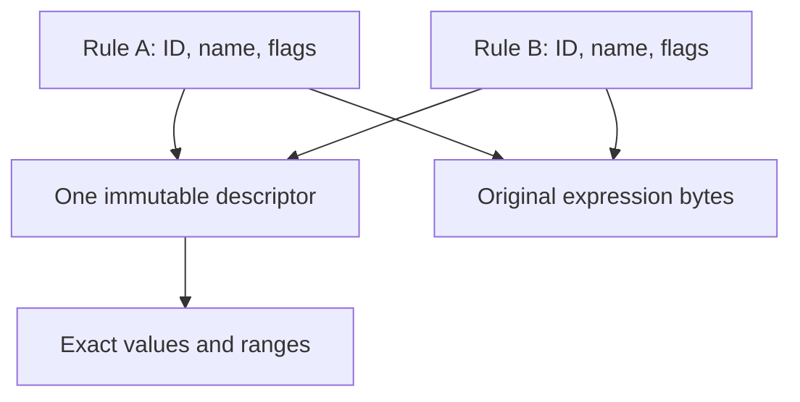

# Logical sharing: implementation, rejection gate and corrected memory accounting

28 October 2026 UTC. **The experimental implementation saves memory but fails the strict duplicate-alert ordering gate. It is preserved as a patch and Git branch, and is not enabled in the retained scanner.** The ordinary corpus passes and strong-threat fixtures pass, but those successes do not override the ordering failure. The retained runtime is the previously saved fork; this pass retains diagnostic corrections, an expanded memory inventory, research and reproducible experimental evidence.

Read [the algorithm/data-structure inventory](memory-algorithm-inventory.md), [22 newly reviewed literature entries](memory-literature-update.md), and [the immediate lead log](complexity-shift-leads.md). The quarter-memory target of 202.042 MiB remains unmet. No deployment or external publication was performed.

## What was implemented

Each logical rule previously embedded a 136-byte target description block (TDB), including pointers into its own value/range/string/macro arrays. In the experiment, a rule points to an immutable matcher-owned TDB. Identical descriptors share that object; identical expression strings share their original bytes. Rule IDs, flags, bytecode indices, names and order remain per rule. The record shrinks from 168 to 40 bytes on this 64-bit build.

`lsig-store.c` reuses ClamAV's existing string hash table. A full key includes three array counts, subsignature count, all ten field-pointer coordinates, macro presence and every auxiliary byte. NULL differs from a pointer to a zero value. Complete comparison establishes equality; hash fingerprints are never accepted as proof. Hex encoding adapts binary construction keys to the existing non-binary-safe string table, and is never decoded during scanning. Unique objects and their keys live until matcher destruction; no reference counting, cache eviction, locks, weak references or cross-engine sharing is introduced.

All subsignatures and macros are parsed before descriptor ownership transfers. Successful duplicate insertion releases the parser's redundant allocations; failure retains caller ownership. TDB cleanup is consolidated from two macros into a single helper. C and Rust private layouts are changed together. Shared expressions remain text, evaluated by the same recursive evaluator. The zero descriptor for temporary Yara verification is immutable.

This moves ownership and deduplication work into loading. It adds a loader module and equality/ownership invariants, so it is not proof that total implementation complexity decreases. It avoids an additional scan-time codec and does not introduce a new runtime tuning flag. The rejected code is isolated as [an experimental patch](../experiments/logical-sharing.patch), not maintained as a second default scanner configuration.

The diagram describes data ownership only. Changing these allocations indirectly changes existing address-based sort ties elsewhere; that is the reason this seemingly isolated optimization was rejected.

## Measurements: rejected prototype, not the retained default

Same database: main 63, daily 28164, bytecode 339, 3,628,192 signatures. Same full-feature Release configuration, GCC 13.3 and Rust 1.90, pools enabled, AC node IDs/flat nodes/compact logical state enabled, disposable AC builder disabled. The pre-existing experimental flat hash option is ON in both measured libraries; it remains OFF in default source. Scan cache is disabled equally. Public scanner operations use the same probe executable and normal database verification. Diagnostic library copies expose private symbols without disabling scanner functionality.

Two independent processes per variant, serial AB/BA order, pinned to CPU 2 on a shared host. Table entries are means, not confidence bounds or workload averages.

| Observation | Previous flat-hash fork | Logical-sharing experiment |
|---|---:|---:|
| Compiled RSS | 776.127 MiB | 724.434 MiB |
| Construction high-water RSS | 929.623 MiB | 878.076 MiB |
| RSS after corpus passes | 801.688 MiB | 750.117 MiB |
| Database load | 9.507 s | 9.622 s |
| Compilation | 3.778 s | 2.638 s |
| First-hit corpus pass | 87.316 s | 76.820 s |
| All-match corpus pass | 119.688 s | 111.901 s |

Compiled memory decreases **51.693 MiB (6.66%)**; construction high-water decreases **51.547 MiB**. Prototype compiled RSS ranges 724.418–724.449 MiB, versus 776.023–776.230 MiB before. The first-hit timing ranges are 75.110–78.530 s versus 82.181–92.452 s; all-match ranges 107.450–116.352 s versus 118.215–121.161 s. Load time is slightly higher on average. These runs are encouraging but cannot establish general speed parity, tail latency or attacker-resilient throughput.

The corpus contains 3,319 WordPress 6.8.3 and ClamAV test files, totaling 85,031,530 bytes. PHP was not executed. Each mode detects 87 files, reports zero errors, and emits respectively 87 or 89 callbacks. Every process has identical return-code/name/ordered-callback transcript hashes on this corpus. The corrected logical header/template/expression exports and raw name/token exports also match exactly. Candidate/node references and some pattern reference fields differ; whole-graph ordered equivalence is **not** claimed.

At 724.434 MiB the prototype would still exceed the quarter target by 522.392 MiB, before hosting coexistence/reload qualification. Because the prototype is rejected, the retained fork receives **no claimed additional scanner memory saving** from this pass. The ~776 MiB figure is the measured opt-in flat-hash configuration, not stock ClamAV or a measured SiteGround deployment.

## Why the gate fails

`matcher-ac.c::sort_list_fn` and `sort_heads_by_partno_fn` use pattern addresses to break ties. Those addresses reflect pool allocation order and object sizes. Consequently a change that never sorts or rewrites alerts can still alter the linked traversal constructed by the existing comparator.

The dedicated test loads 10,000 identical-pattern rule pairs with 10,000 harmless hash distractors. Before and after both select `Foundations.Order.09884.UNOFFICIAL` first and produce the same 20,000-alert multiset. But the ordered all-match digest changes:

| Variant | Ordered SHA256 | Final reported name |
|---|---|---|
| Previous fork | `05801c7b3c05455d51a77fc535ed4d69092718695e5c00a07bed67d0e2ef6a56` | `Foundations.Order.00001.UNOFFICIAL` |
| Sharing experiment | `245d9a4dbe88125adb7d7bdd06902c37a173d901a33debe672b791e542070b7a` | `Foundations.Order.00002.UNOFFICIAL` |

Two repeats of each binary reproduce its own sequence. This is not dismissed as timing noise. The separate weak/PUA versus strong fixtures, with the strong rule at indices 0, 5000 and 9999 and repeated first-hit scans, all preserve the strong result. Thus no downplayed threat was demonstrated here, but the stricter observable-order contract fails.

Replacing address ties with insertion IDs would define a new order. Simulating the historical allocator to reproduce old address ranks would add complexity. Compacting after linked order is frozen may be viable, but mixed pool pages retain freed fragments and relocation has ownership/peak costs. None is silently substituted for the current contract. The experiment is retained for future investigation and excluded from the active source tree.

## Exact accounting and the earlier diagnostic defect

The parser's `cnt[CLI_TDB_RANGE]` already counts individual uint32 elements: it increases by two per range. Earlier census and export code multiplied it by two again. The census overcounted; the exporter read past the logical array allocation. This did not affect the production parser or scanner. Both diagnostics are corrected in the retained source.

The old counted auxiliary total 9,313,879 bytes becomes 6,806,567 bytes for the same previously counted categories, a **2,507,312-byte (2.391 MiB) correction**. Including string and macro arrays that the old census omitted gives 6,807,226 bytes. The old 1,500-template count is invalid; the corrected standalone exporter finds 1,205 unique eligible templates plus 82 escape records. Its domain differs from the actual per-matcher interner, which supports those additional fields and duplicates across targets separately.

| Fully counted logical allocation | Previous fork | Experimental sharing |
|---|---:|---:|
| Rule headers and pointer directory | 54,966,560 B | 14,990,880 B |
| Full auxiliary arrays and expression text | 6,807,226 B | 49,463 B |
| Separate unique TDB headers | Included inline | 169,728 B |
| Retained descriptor key strings | 0 B | 339,282 B |
| Interner objects and table capacities | 0 B | 117,504 B |
| Total, names/allocator rounding excluded | **61,773,786 B (58.912 MiB)** | **15,666,857 B (14.941 MiB)** |

There are 1,248 descriptor objects and 1,479 expression strings across matcher-local stores. Net counted reduction is **46,106,929 bytes (43.971 MiB)**. The larger RSS reduction also reflects allocation placement/rounding and residency; it is not evidence that all unexplained memory is fragmentation. Corrected old partial-layout totals and all downstream logical-template budgets must be recomputed; historical non-logical measurements and RSS observations remain independently valid.

## Worst-case and average-case limits

There is no defensible SiteGround average from a single signature snapshot. Above measurements characterize this database, build and corpus. For N rules, U unique descriptors, E unique expressions, A bytes in unique descriptor arrays and P bytes in unique expression strings, the experimental counted logical cost on this build is approximately:

`48N + 136U + A + P + (241U + 2A) + 24(Cd + Ce) + 64R`

Cd/Ce sum hash-table capacities and R counts stores; names, matcher-root headers and allocator overhead are excluded. The 241-byte descriptor key prefix includes 120 binary metadata bytes encoded as hex plus NUL. The old cost is `176N + repeated auxiliary bytes + repeated expression bytes`.

If every descriptor is distinct, moving the inline TDB adds 8 bytes per rule even before keys/indexes. Keys add 241 bytes plus twice its auxiliary bytes per descriptor; both tables add capacity overhead. Under ordinary successful growth, capacity is at most roughly 2.5 times the entry count after the initial minimum, with small-boundary effects. Thus **worst-case savings can be negative**. For illustration only, all-distinct descriptors with 16 auxiliary bytes and distinct short expressions cost roughly another 341–401 bytes per rule at ordinary table load factors, excluding rounding. This is not a universal upper bound on arbitrary signature metadata.

Lookup collision equality is exact. Scan inputs cannot cause interner work after loading, so the scan's hot path has no new hash-flood mechanism. Custom database construction can still provoke expensive collision behavior in the reused non-cryptographic table; no new worst-case-linear load-time guarantee is claimed. The largest per-key temporary and retained key/index allocations also need accounting. No loss of detection, lower scan limits, approximate membership or skipped signature family is used to obtain the measurements.

## Validation and reproducibility

- Full C test suite: 1,816 checks; Rust: 65 tests; scanner: 145 passed, one skipped, five subtests passed. C/Rust affected layouts agree.
- Targeted ASan/UBSan harness compiles the production store and hash-table sources with tracked individual allocations. It checks 1,008 distinct descriptors, 1,000 duplicate reuses, pointer/NULL/macro/string differences, expression sharing/growth and six first-insertion allocation failures with retry. Zero tracked live allocations remain after destruction.
- LeakSanitizer could not run in this environment; the successful run disables it. The complete shared engine is not sanitizer-instrumented. No claim of complete failure-injection coverage, full no-pool build, 32-bit/big-endian qualification or daemon/reload stress is made.
- Four public-API corpus process runs match as described above. Strict duplicate order fails and is recorded as a failed acceptance test, not converted into a pass. Strong-threat selection tests pass.
- A final const-correctness rebuild produces the identical diagnostic-library SHA256 used for the measurements.

Raw aggregate outputs, evidence hashes, build/database/corpus provenance and commands are in [logical-sharing-results](logical-sharing-results/README.md). Signature databases, downloaded WordPress sources and generated raw signature exports are excluded from the deliverable. The local history bundle contains the experimental branch; the patch is based on the recorded retained diagnostic revision.

The retained changes to scanner-adjacent tools are the corrected range count, complete logical auxiliary accounting, and expanded private-layout verification. They do not alter scanner runtime behavior. Further memory work should first address the coupling between allocation addresses and observable order, then investigate source-proven redundant fields and existing compaction phases, rather than layering additional decoders onto this failed change.
