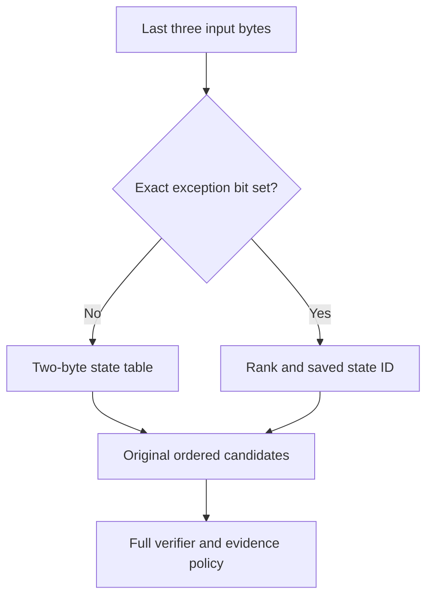

# Correctness repair and the next memory boundary

27 October 2026. Fix commit: `9c705c5`. Upstream base:
`dd3aa1907cf6e34286c86f8a24dd16e7a8d8810d` (1.6.0-devel).

The mixed-severity detection regression is fixed while retaining the compact
engine layouts. The fourfold whole-scanner memory reduction is **not achieved**.
This report separates shipped matcher changes, measurements of standalone
representations, and designs that still need implementation and qualification.
No SiteGround or WordPress installation has been changed.

Follow-up: [the correlated research report](correlated-optimization-opportunities.md)
adds executable representation experiments and corrects the name-ownership bound
below: retiring each compressed block after permanent expansion avoids retaining
both complete representations. The original codec measurements remain valid.
The same follow-up records the clarified acceptance contract: slower exact
settings are acceptable when a selectable configuration preserves current
performance characteristics; each setting must retain result correctness.

## What the fix changes

Previously, AC and Boyer–Moore could return the first matching candidate before
the caller classified its evidence. If that candidate was weak, deferred PUA,
or ignored by an alert callback, the caller resumed other scanning work but
could not resume the lost candidate cursor. A later strong indicator could be
missed. Changing allocation addresses exposed different instances of this
upstream order sensitivity.

Both matchers now classify evidence while their candidate cursor is live.
They continue after a nonterminal result and stop on a terminal result. The
caller no longer appends the same alert again. Callback stop/trust results and
errors propagate through the target and generic matcher paths. Multipart AC,
logical-subsig accounting, ordinary AC, and BM are covered. Explicit heuristic
precedence remains an intentional user policy; this fix does not override it.
No-context file typing and result-collection paths retain their behavior.

Continuing correctly can discover more nonterminal evidence than the broken
early-exit path did. Its candidate work and existing evidence allocations can
therefore increase on weak/PUA-heavy input. Clean-input RSS does not bound that
case. Suppressing those matches to reproduce the old low cost would reintroduce
the defect or change evidence semantics. Weak/PUA floods belong in the corrected
baseline's adversarial and memory qualification, alongside all-match floods.

The fix needs no new persistent table or scan buffer. It retains flat node IDs,
compact transitions, split pattern extensions and compact logical scan state.
The disposable construction pool remains opt-in: fixing severity loss does not
make its address-dependent first-name ordering identical to the guarded default.
Nor does this fix promise identical labels between upstream and the compact
fork when several strong signatures match. It preserves the previous compact
order on the supplied all-strong fixture and prevents the demonstrated weak/PUA
masking cases. Reordering evidence is not used as a memory optimization.

### Validation of the repair

| Check | Observed result |
| --- | --- |
| Default compact C suite | 1,816 checks, zero failures/errors; 31 new regression checks |
| Native-pointer C suite | 1,816 checks, zero failures/errors |
| Scanner integration | 145 passed, 1 existing skip, 5 subtests passed |
| ASan/UBSan matcher suite | 44 checks passed |
| ASan/UBSan regex suite | 212 checks passed |
| 20,000-rule mixed-severity fixture | Strong found for both anchor positions, weak and PUA variants, first-match and all-match |
| All-strong order fixture | First name and full ordered output match the previous compact build |

The new checks include ignored alerts, BREAK/VERIFIED callbacks, absence of
double callbacks, weak-only/PUA-only input, explicit heuristic precedence and
logical accounting after a weak hit. Sanitizer runs disable leak checking due
to this environment; Rust code is not sanitizer-instrumented. This is not an
all-parser fuzzing result. The opt-in pool's new runtime behavior has not been
separately qualified; its earlier measurements remain historical. No new Rust
test run or hosted CI result is claimed.

In three fresh-process runs of the verified official database, previous compact
compiled RSS averaged **824.333 MiB**, and fixed compiled RSS **823.947 MiB**.
Observed ranges were 824.207–824.422 and 823.898–823.977 MiB, respectively.
The difference is allocator/process noise, not a memory-saving claim. Fixed
peak RSS averaged 824.382 MiB in this small-input experiment. These runs establish
that the repair retained the memory optimization, not a production worst case.
Source, input, database and binary hashes are recorded in the accompanying JSON.

Thirty randomized paired synthetic trials per input also completed. The paired
geometric-mean fixed/before scan-time ratios were 0.950 for 4 KiB clean input,
0.876 for 4 MiB clean input and 0.884 for detected input. Their bootstrap 95%
intervals were respectively **[0.691, 1.289]**, **[0.752, 1.028]** and
**[0.661, 1.166]**. All cross 1.0. These noisy shared-host measurements establish
neither a speedup nor a tight no-regression bound. They use synthetic logical
rules and do not substitute for official-database or SiteGround qualification.

## The target and the accounting boundary

The best earlier experimental setting averaged **808.168 MiB**, so its quarter
is **202.042 MiB**, approximately **211.856 million bytes**. The previous
200-decimal-MB objective is stricter: 190.735 MiB. Neither should be silently
substituted for the other. The current guarded build is about 824 MiB because
the pool experiment is still opt-in.

For SiteGround, success must include the scanner's charged file cache, resident
engine, private scan/parser state and required update/reload overlap. PHP,
WordPress, database and other hosting processes are additional consumers of
the hosting allowance. There is no verified host-specific allowance or workload
in this test environment, so no remaining WordPress headroom is asserted.
Moving bytes to mapped files, an updater process, or another generation does
not by itself reduce the deployment total. Virtual address size is a different
quantity from resident and cgroup-charged memory.

The snapshot contains 3,628,192 loaded signatures. Database versions and trust
verification are documented in [the earlier report](demand-engine-implementation.md).
All normal signature verification remains enabled. Official databases and raw
signature exports are deliberately excluded from this source package; their
provenance and aggregate measurements are included.

## What the real database offers

The census covers AC patterns/logical rules and the file/section/import/false-
positive hash matchers. It is not a complete allocator census: BM, PCRE,
bytecode, parser/runtime allocations and several auxiliary tables need separate
accounting. Name measurements concern the 3,547,706 distinct names found in that
census, not every possible engine string.

| Component or property | Measured quantity | Consequence |
| --- | ---: | --- |
| AC pattern records plus pointer directory | 156,853,840 bytes | Largest directly identified record-layout opportunity |
| AC candidate links plus pointer directory | 72,957,408 bytes | Replace pointers with IDs and contiguous storage, preserving traversal order |
| AC token payload | 90,363,298 bytes | Exact sharing and byte-specialized storage are promising |
| Byte-only patterns | 1,280,869 / 1,508,210 (84.93%) | Most records need not store every byte in a 16-bit token |
| Any-offset patterns | 1,497,514 / 1,508,210 (99.29%) | Store the common offset policy implicitly; retain an exact escape representation |
| Logical subsignature patterns | 1,466,782 / 1,508,210 (97.25%) | Separate common logical references from uncommon standalone fields |
| Token runs | 38,725,083 / 45,181,649 tokens (85.71%) | Run-length encoding is a poor general fit for this corpus |
| Current logical records plus directory | 54,966,560 bytes | Default templates and narrow IDs deserve a separate serializer experiment |
| Full hash keys, excluding names and indexes | 51,419,900 bytes | A tiny perfect-hash index does not eliminate these exact keys |

### Lossless token experiment

There are 1,066,576 distinct token strings among 1,508,210 pattern records.
Deduplication alone reduces token payload from 90,363,298 to 59,505,378 bytes.
Storing byte-only strings as bytes reduces distinct payload to 31,609,521 bytes.
Adding a 32-bit reference per pattern and a 32-bit offset per distinct string
gives **41,908,669 bytes (39.967 MiB)**, versus **86.177 MiB** originally: a
**46.210 MiB** representation-level saving.

This is an exact equality census, not probabilistic deduplication. It excludes
encoding flags, alignment, builder scratch and verifier changes. A pattern must
still retain its own prefix boundary, lengths, special tables, offsets and
logical metadata; identical token bytes do not imply identical rules. Count the
per-pattern reference only once if it moves into the new pattern record.

The byte-only format can compare directly against uncompressed input rather
than expanding the entire pattern before verification. Whether narrower loads
and better cache residency offset dispatch cost requires an integrated matcher
benchmark. On a custom database with all unique, tagged strings, sharing saves
nothing and its indexes add space. Select a raw format when the complete encoded
block is larger; bounds-check IDs and retain wide fallbacks for oversized data.
This prevents storage expansion per selected block, not every possible latency
regression.

### Name compression: an actual codec trial, and its catch

The raw distinct NUL-terminated strings occupy 83.133 MiB. The standalone codec
probe used the author's OptFSST repository at commit
`be06199760288005e2ebdc11fbd0f087903c0476`, scalar build, and decoded and compared
every string including its terminator.

| Representation | Encoded bytes + lookup index + resident decoder | Lookup work / limitation |
| --- | ---: | --- |
| Raw strings | 83.133 MiB | Existing stable pointer behavior |
| FSST | 48.853 MiB | Independent string decode |
| OptFSST | 44.765 MiB | Independent string decode; 4.087 MiB smaller than FSST here |
| Front coding, restart every 8 | 34.428 MiB | Up to 8 dependent string reconstructions |
| Front coding, restart every 16 | 29.015 MiB | Up to 16 reconstructions |
| Front coding, restart every 32 | 26.309 MiB | Up to 32 reconstructions |

The front-coding figures include two uint16 lengths per string and a block
offset directory. They are exact encoding-size calculations with reconstruction
checks, not a scanner implementation. Codec encode timings in the raw output
are single observations under an uncontrolled shared host and are not performance
qualification. OptFSST's extra encoding work matters for updates.

**Do not book these name savings as worst-case engine savings.** The public
scan APIs return a statically allocated name, and Rust evidence retains the
original `static_virname` pointer (`clamav.h`, `libclamav_rust/src/evidence.rs`).
An evicting decode cache would invalidate pointers. An engine-lifetime arena
preserves compatibility but may eventually materialize all names: raw names
plus the OptFSST representation already total **127.898 MiB**, before cache
bookkeeping. A stable file mapping changes the paging/I/O boundary rather than
guaranteeing low charged RAM and unchanged latency. A new caller-owned-name API
would be useful, but cannot be counted as preserving the existing API by itself.

## Research synthesis, including October 2026 work

The previous proposals emphasized compact resident layouts, double-array AC,
succinct matching, small perfect-hash indexes, string compression and conditional
demand paging. The new evidence favors keeping exact hot matching resident and
compressing its representation before adding prediction or eviction. The
following distinctions matter more than a paper's headline compression ratio.

| Research | Applicable idea | Limitation for this fork |
| --- | --- | --- |
| [Kanda, Akabe, Oda, double-array AC, revised 2024](https://arxiv.org/html/2207.13870v3) | Compact state arrays; 12-byte state variant | Port short anchors and preserve output semantics; packed base limits need wide fallback; sparse transitions introduce failure work |
| [Belazzougui, succinct dictionary matching](https://arxiv.org/abs/1001.2860) and [Kosolobov–Sivukhin, compressed multiple-pattern matching](https://arxiv.org/abs/1811.01248) | Space-efficient exact routing with strong asymptotic results | Literal-pattern models do not include ClamAV's wildcard verifiers, logical rules, callbacks or stable name storage |
| [PtrHash, SEA 2025](https://doi.org/10.4230/LIPIcs.SEA.2025.21) and [PHastR v3, 16 October 2026](https://arxiv.org/abs/2610.17833v3) | Compact static placement with fast lookup | PHastR is a preprint; 1.94 bits/key is an index, not exact membership storage. Its billion-key timings do not predict this engine |
| [Non-minimal k-perfect hashing, ESA 2026](https://doi.org/10.4230/LIPIcs.ESA.2026.20) | Put exact keys in a cache-line-sized bin | Empty slots cost full-key capacity. At load factor 0.8 that is 25% extra payload; cited gains concern much larger sets and particular CPUs |
| [OptFSST, ADMS 2026, revised 26 August](https://arxiv.org/abs/2607.11271v3) | Better symbol selection/encoding with independent decode | Actual name experiment above is promising, but pointer lifetime and slower encoding remain; paper-wide averages are not whole-engine savings |
| [FastLanes file format, VLDB 2025](https://duckdb.org/library/fastlanes/) | Small independently encoded groups, narrow fields, SIMD-friendly arrays | An architectural inspiration for metadata; per-candidate decompression must be measured, not assumed free |
| [RLE dictionary matching, Algorithmica 2026](https://doi.org/10.1007/s00453-026-01398-0) | Work proportional to compressed runs on suitable data | This corpus retains 85.71% as many runs as tokens; arbitrary attacker input need not be repetitive |
| [Random access in grammar-compressed strings, ICALP 2026](https://doi.org/10.4230/LIPIcs.ICALP.2026.86) | Explicit compression/access tradeoffs and lower bounds | Supports scrutinizing decode latency; does not prove a 202 MiB ClamAV impossible |
| [Binary fuse filters](https://doi.org/10.1145/3510449) and [Ribbon, JACM 2026](https://doi.org/10.1145/3785417) | Small negative filters/static retrieval | Do not replace exact membership. An attacker can repeatedly force backend work through known positives or false positives |

For 3,213,522 hash records, 1.94 bits/key is about **0.743 MiB**. Saving another
0.8 bit/key is only **0.306 MiB**. A more predictable lookup path can therefore
be worth that extra index space. Full hashes, size/type distinctions, duplicate
names and allowlist semantics must remain exact. Hash placement needs collision
verification and a bounded-construction fallback; fingerprints alone are not an
equivalent replacement for the existing digest keys.

GPU results such as [FastPair, September 2026](https://arxiv.org/abs/2609.15034)
do not establish performance on the intended CPU hosting environment. Moving
the scanner to an accelerator, remote service or extra RAM tier changes the
deployment assumptions. Prediction similarly cannot guarantee that attacker-
chosen inputs will remain within a small working set.

## Three competing routing implementations

These are alternatives for a target's routing representation, not three
simultaneous caches. The common contract retains exact candidate order, full
verification, all signature families, callback/error policy and configured
resource limits. None has yet met the complete 202.042 MiB objective.

| Alternative | Mechanism | Strength | Weak point |
| --- | --- | --- | --- |
| A. Exact short-window directory | For depth ≤3, map the last three bytes to the same state; dense 2-byte table plus exact bitmap/rank overrides | Fixed number of lookups; no collision chains or failure walk; tested diagnostic below | Fixed ~3.25 MiB overhead per target is wasteful for tiny roots; integration must preserve outputs, chunk state and variable-depth fallback |
| B. Double-array AC | Pack sparse edges into base/check arrays and retain failure/output state | Potentially much smaller than completed rows; established literature | State packing/build cost, failure-path traffic and output traversal; performance on attacker-selected transitions needs measurement |
| C. Shared completed microblocks | Partition a completed row into small blocks; intern identical blocks and keep a row directory | Preserves one transition per byte and ordinary arbitrary-depth semantics | Additional dependent lookup; adversarially irregular rows may not compress; no real-database implementation measured here |

For B, 555,935 existing states at the paper's 12-byte record size would be
6.362 MiB *before unused slots, output/candidate structures and compatibility
data*. This is a dimensional estimate, not a constructed ClamAV automaton.
For C, a 16-byte alphabet block holds 64 bytes of uint32 state IDs; a row
directory of sixteen uint32 block IDs costs 64 bytes. Relative to a 1,024-byte
row, it wins only when shared blocks save more than that directory and supporting
metadata. It can otherwise keep the original dense row. Neither is credited
with measured scanner savings.

### How A works in plain terms

The current table says, "given my previous state and this byte, which state is
next?" A short-anchor directory instead asks, "what state corresponds to these
last three bytes?" Most three-byte sequences have no special case. For those,
the smaller last-two-byte table gives the answer. An exact bit marks exceptions,
and a population count locates the saved state ID. Full pattern verification
still follows; three bytes are a routing key, not a malware verdict.



`probe_short_anchors.c` builds this representation alongside the existing
engine, exhaustively compares all 2^24 three-byte keys for each applicable target,
and compares every state on three longer PE-target streams. Its size accounting
replaces **transition rows only**; it retains node/output identities as an oracle.
The probe is not linked into the scanner. Its timing excludes prefiltering,
candidate walking, verification and parsing. A minimum-size choice between a
directory and existing rows is essential for small roots. Deeper custom tries
must retain the original route until separately supported.

The completed run checked **201,326,592 three-byte keys** across all **12 active
targets**. Every comparison passed, as did every-byte state comparison on three
8 MiB PE streams. Choosing directories for targets 0, 1, 2 and 6 and retaining
rows elsewhere gives **22,316,024 bytes (21.282 MiB)** of routing tables, versus
**78,815,232 bytes (75.164 MiB)**: **53.882 MiB saved**. The PE target alone falls
from 57,078,784 to 5,137,452 bytes (54.435 to 4.899 MiB). Node and output storage
is unchanged in this calculation. The selection is a calculation over built
representations, not an integrated engine option.

| PE routing-only input | Dense median, seconds | Directory median, seconds | Paired directory/dense ratio, 95% bootstrap interval |
| --- | ---: | ---: | --- |
| Random bytes | 10.3191 | 0.1764 | 0.01854 [0.01501, 0.02365] |
| All zero | 0.0743 | 0.0422 | 0.55768 [0.52208, 0.59501] |
| Repeated bytes 0 through 255 | 0.1986 | 0.0447 | 0.22444 [0.21269, 0.23704] |

There are 30 alternating-order pairs per stream, pinned to CPU 2. Checksums
also agree. The unusually large random-input advantage is specific to this
host and this isolated dependent-lookup workload. It must be reproduced on
representative hardware and the complete scanner before any speed claim. In
particular, the existing prefilter may skip most routing in ordinary scans,
and expensive candidates may dominate adversarial scans. These results select
A as the first integration experiment; they do not make B/C unnecessary if A
fails on real scan boundaries, different roots or adverse access patterns.

### Savings and worst-case qualifications

| Change | This snapshot's representation saving | Worst-case qualification |
| --- | ---: | --- |
| Selected short-window routing tables | 53.882 MiB | Storage is input-independent for a fixed database; other/deeper databases may select dense fallback and save zero. End-to-end latency is unqualified |
| Shared byte-specialized tokens, including two indexes | 46.210 MiB before omitted overhead | Unique tagged tokens may save zero; choose raw storage when a complete encoded block loses. New dispatch/metadata costs remain unmeasured |
| OptFSST names | 38.367 MiB before decoded-name retention | Stable-pointer materialization may erase savings or increase total memory; no worst-case saving credited |
| Front-coded names, restart 16 | 54.118 MiB before decoded-name retention | Same pointer issue plus up to 16 dependent reconstructions; alternative to OptFSST, not additive |
| Three-ID candidate records | Arithmetic ceiling 43.486 MiB | Not implemented; supporting indexes and exceptional cases reduce savings |
| 32-byte common pattern records | Arithmetic ceiling 103.561 MiB | Not implemented; uncommon fields, metadata and wide fallbacks reduce savings |

The routing and token component deltas sum to **100.092 MiB** before integration
overhead. They are disjoint, but subtracting that sum from RSS is still not a
measurement: ownership, pool reclamation and the builder must actually release
the old allocations. The table gives a measured snapshot, not a statistical
average over installations, and no column is a worst-case whole-scanner bound.

## Why adding the savings is not yet a fourfold solution

Even with measured deduplicated byte-specialized tokens, three categories alone
would occupy approximately **172.14 MiB**: stable raw names (83.13), full digest
keys (49.04), and token strings plus their indexes (39.97). That leaves only
**29.90 MiB** of the quarter-size target for routing, candidate links, pattern
descriptors, logical rules, hash/name associations, all other engine components,
runtime, scans and updates. It is not a viable complete budget for the layouts
tested here. This is a lower bound for those choices, not for every possible
lossless representation.

Further pointer removal can be substantial, but is not yet a measured result.
For example, the 2,279,919 candidate records currently cost 32 bytes each including
their pointer directory. Three uint32 IDs per record would cost 27,359,028 bytes,
saving **43.486 MiB** before new indexing/alignment. A 32-byte common pattern
record instead of the current 104-byte record-plus-pointer would save at most
**103.561 MiB** across this snapshot, before exception payloads and directories.
Those are arithmetic ceilings for proposed layouts; a field-by-field serializer
and verifier are required before treating them as estimates of deployed RAM.

The strongest next direction is an immutable resident representation with
relative IDs, exact shared token storage, implicit common fields, compact
logical descriptors and bounded routing. It avoids cache prediction as a
correctness dependency. It may reduce enough cache misses to pay for extra
integer work, but that is a hypothesis requiring end-to-end measurement.
It does not yet justify promising 200 MB or unchanged performance.

## Implementation and acceptance sequence

1. **Keep the repair as the correctness baseline.** Differential tests must
   compare evidence strength, full names, multiplicity, callbacks, logical counts,
   offsets, errors and explicit precedence policy. Preserve reference ordering
   rather than making pointer sorting part of the new persistent format.
2. **Integrate the smallest bounded routing candidate behind an experimental
   option.** Freeze state/output IDs; check the depth invariant; preserve chunk
   boundaries, prefilter skips and every output chain. Fallback to existing rows
   for unsupported depth or non-winning roots. Run target/type, file-typing,
   multipart and all-match differential tests before enabling it.
3. **Compile patterns and candidate chains into immutable arrays.** Separate
   common fields from exceptions, use checked relative IDs, preserve duplicate
   order, and specialize raw-byte verification. Intern exact token strings only
   when the final layout wins; retain every special-table and offset dependency.
4. **Compact logical and hash metadata.** Represent common target constraints
   once; share expression programs only after exact equivalence checks. Keep
   full digest keys and exact size/type/name associations. Compare a simple
   sorted index with perfect-hash alternatives on positive, negative and
   attacker-chosen requests before selecting one.
5. **Replace pointer-heavy construction, not just resident output.** A compiler
   which builds the old 800 MiB engine and then compresses it still fails a
   whole-lifecycle 202 MiB requirement. Use bounded chunks, explicit ownership,
   bounded dedup scratch and exact fallback. Measure update time as well as
   peak memory. The performance profile must retain update performance; an
   optional compact profile may trade update time for memory with explicit bounds.
6. **Handle reload generations and name lifetimes explicitly.** Share unchanged
   immutable data when ownership permits, but measure the all-changed update
   case. Retain old data while scans reference it. Establish a compatible bound
   for returned names before claiming name compression. Do not quietly retain
   an unbounded decoded-name arena or bill page cache outside the scanner.
7. **Qualify on the intended deployment.** Use representative WordPress/PHP,
   archives, PE/Office uploads, clean and detected inputs, concurrent scans,
   cold/warm starts, updates and OOM/fault injection. Include collision-heavy
   anchors, every-byte candidates, all-match floods, decoder escape cases,
   malformed metadata, custom deep tries and cache-thrashing file sequences.

The release gate must compare against the **fixed** optimized baseline, so that
doing the extra work required to find a previously hidden threat is not labeled
an optional slowdown to optimize away. For ordinary comparable scans, require
paired throughput/latency/load/update measurements with prespecified confidence
and tolerances, and report p95/p99 as well as typical latency. Require no new
asymptotically unbounded candidate, decode or hash path. A finite benchmark
cannot prove equal speed for all inputs; it can reject regressions and support
a scoped engineering claim. The memory gate must specify concurrency, input
limits and update overlap, since unrestricted archives or all-match output have
no fixed small whole-process worst case in the original engine either.

Optional tuning can expose name restart interval, dense-versus-packed routing,
raw-versus-encoded metadata and bounded prefetch budgets. These remain explicit
memory/time choices. Under the clarified requirement, slower exact settings are
acceptable when a selectable configuration meets current performance
characteristics. Report each profile's own memory and timing together. A slower
setting can qualify against its declared compact-profile envelope, but cannot
establish that the performance profile meets the same memory target. See the
[current configuration contract](correlated-optimization-opportunities.md#configuration-contract-after-the-clarification).

## Reproduction and evidence

Use GCC 13.3 and `RUSTUP_TOOLCHAIN=1.90.0`, matching configuration headers and
libraries. The fix was benchmarked from a dirty working tree based on `383ab57`
before being committed as `9c705c5`; binary hashes in the raw results identify
the actual artifact. The later whitespace-only cleanup has no semantic effect.
The fixed native and sanitizer configurations were built separately. Historical
pool results are not measurements of the repaired pool configuration.

The `tools/compact-memory` directory contains `check_alert_severity.py`,
`check_alert_order.py`, `measure_database.py`, `compare.py`, `engine_census.c`,
`profile_encoding.py`, `probe_name_codec.cpp`, `probe_short_anchors.c` and
`analyze_frontier.py`.
Compile the census as described in the previous report, then optionally pass
two extra paths for length-prefixed name and token exports:

```sh
build/engine-census database certs names.bin tokens.bin > census.jsonl
python3 tools/compact-memory/profile_encoding.py \
  --names names.bin --tokens tokens.bin --output encoding.json
```

The name probe requires the pinned external OptFSST source, which is not bundled
or linked into ClamAV. Build its `libfsst.cpp` and `fsst_avx512.cpp` with C++20,
`-O3 -DNDEBUG -DFSST_DISABLE_AVX512=1`, then link the probe with those objects and
`-lpthread`. The short-anchor probe uses the same internal headers/library as
the census, `-O3 -mpopcnt`, and a flat-node build. Run it serially, on a pinned CPU,
with `database certs`. The delivered aggregate evidence is in
[`frontier-results`](frontier-results/); raw diagnostic exports are not needed
to review the reported calculations.
