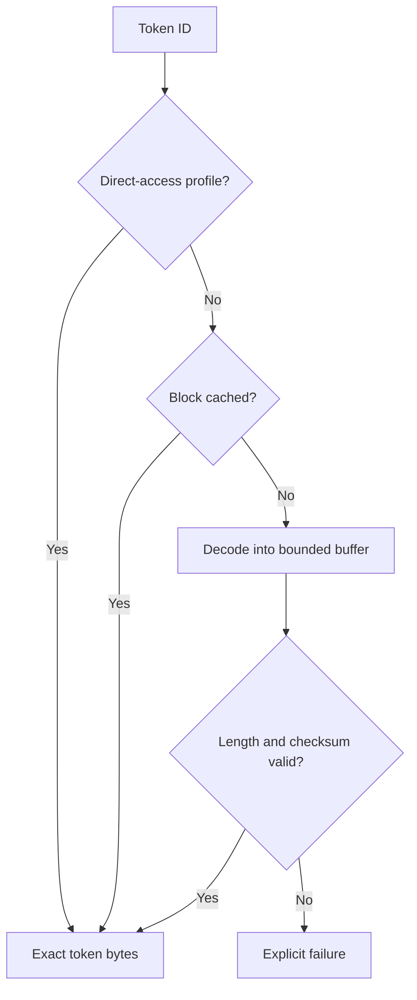

# Exact, tunable memory profiles: prototype results

> **Correction, 28 October 2026:** The old logical TDB exporter treated the range element count as a pair count, over-reading diagnostic data and overstating auxiliary bytes. Its logical-template counts, logical-layout totals and dependent aggregate estimates are superseded by [the corrected implementation report](logical-sharing-implementation.md). Production scanner range handling was unaffected. Earlier RSS observations and independently measured non-logical layouts are not invalidated by this diagnostic defect.

27 October 2026. This work adds standalone native codecs, exact database exporters,
preparation tools, reproducible tests and measurements. It does **not** enable a
new representation in the scanning engine. The existing regression repair and
engine source are unchanged. Read [the evidence and commands](profile-prototype-results/README.md)
alongside this report.

## Decision after the acceptance-criteria change

The clarification permits a family of exact configurations: at least one must
meet current performance characteristics, while other configurations may trade
time for memory. It makes bounded decoding, compact scalar fields, and optional
compressed token storage eligible for further development. It does not permit
dropping signatures, changing threat priority, hiding errors, or presenting the
smallest configuration's memory together with a different configuration's speed.

I recommend this implementation order:

1. **Share identical immutable logical descriptors and expression bytes.** Keep
   direct access to their common fields initially. This removes a major source
   of duplication without changing the logical expressions or rule order.
2. **Offer packed pattern and candidate metadata as a compact option.** Preserve
   the current native representation as the performance alternative. Its common
   code paths must be benchmarked again after integration.
3. **Keep token block compression optional.** Prefer 4 KiB blocks as the next
   latency-conscious experiment. The slightly smaller 256 KiB layout has an
   unattractive adversarial miss cost. Neither has passed a scanner availability
   qualification.

The new results are strong evidence of representation redundancy, not proof of
production performance or the requested whole-engine memory target.

## What was implemented and measured

The unchanged engine loaded the same normally verified snapshot used by the
earlier experiments: main 63, daily 28164, bytecode 339, with 3,628,192 signatures.
This is a controlled comparison, not a claim that these are today's databases.
MiB means 1,048,576 bytes throughout.

| Component and accounting boundary | Existing allocated payload | Smallest new layout | Reduction |
| --- | ---: | ---: | ---: |
| 1,508,210 pattern records and their pointer directory | 149.587 MiB | **12.012 MiB** | 91.97% |
| 2,279,919 candidate link records and their pointer directory | 69.578 MiB | **8.223 MiB** | 88.18% |
| 312,310 logical records, pointer directory, and counted value/range/expression allocations | 61.303 MiB | **1.541 MiB** | 97.49% |
| Pattern and prefix token arrays | 86.177 MiB | **22.219 MiB** | 74.22% |
| **These four accounting categories together** | **366.645 MiB** | **43.995 MiB** | **88.00%** |

The token minimum uses 256 KiB blocks and a 1 MiB decoded cache. Pattern size
includes the remaining extension-pointer directory; extension contents and
special tables remain outside this table. The logical figure counts conservative
old-record fallbacks for unusual descriptors, but not every exceptional auxiliary
allocation. Names are counted separately below. Allocator rounding is excluded.
The old engine and exports remain alive during the probes; these are replacement
layout bytes, **not measured process RSS or build peaks**.

### Prototype 1: exact scalar columns with bounded access

`export_exact_layouts.c` gives each pattern, candidate link and node an ID only
after the engine finishes its normal construction and sorting. It exports all
pattern scalar fields, names as exact string IDs, token IDs, and extension IDs.
For candidate lists it retains all three references: pattern, next, and
next-same. It also exports node list heads and failure links. No candidate or
evidence order is sorted for compression.

`probe_scalar_columns.c` partitions these records into groups of 64, 256 or
1024. For each field in each group it selects one of four exact encodings:

| Encoding | Stored information | Work for one field |
| --- | --- | --- |
| Constant | One value | Return that value |
| Affine | Starting value | Add the row number, preserving uint32 wraparound |
| Frame of reference | Minimum plus packed differences | Load and mask the requested difference |
| Default plus exceptions | Common value, bitmap, rank prefixes and full exception values | Test one bit; at most one popcount and exception lookup |

Each column descriptor occupies 12 bytes. The exception representation stores
a 16-bit prefix rank per 64-bit bitmap word, so accessing a field does not walk
through earlier exceptions. Reads allocate nothing and never decompress a whole
record group. Selected minima use groups of 1024 for patterns, 256 for links and
logical headers, and 64 for node outputs.

The original pattern structure plus directory takes 104 bytes per pattern.
The new normalized record takes 74 bytes before column encoding. The complete
packed pattern layout, including extension references, averages 8.35 bytes per
pattern on this database. This is an observed database average, not a bound for
arbitrary custom signatures. Constant/default-heavy fields explain much of the
gain; the prototype is not a learned model.

Checks reconstruct **143,529,231 field values** across the twelve schema/group
configurations and compare them with the exported originals. The exporter also
checks every pointer-to-ID reference it emits. These establish fidelity of the
export and codec boundary; they do not replace scanner differential testing.

### Prototype 2: identical logical templates and expression strings

`prepare_logical_store.py` preserves one header per logical rule and interns
byte-identical target descriptors and expression strings. It finds:

- **1,500 distinct eligible target descriptors** among 312,310 logical rules.
- **1,093 distinct normal expression strings**.
- **82 descriptor escapes**, retained in their original representation.
- No code-pointer expression escapes in this particular snapshot; the format
  reserves an escape path for them.

Descriptors retain all counted values and ranges, the sub-signature count, and
exact coordinates for target, engine, OS, entry point, size, container and handler
references. Descriptors with strings, icon groups, intermediate containers,
macro IDs or unexpected pointer layouts take the escape path. A null pointer
remains distinct from a pointer to a zero value. Expressions are shared by exact
bytes including the terminator; there is no Boolean simplification.

Eligible template payload plus its directory occupies 109,856 bytes; shared
expression payload plus directory occupies 29,999 bytes. With ordinary 28-byte
headers instead of packed columns, the same counted logical data would occupy
**8.489 MiB**, an 86.15% reduction against 61.303 MiB. This is a useful intermediate
design: most of the saving is available before adding bit-level field decoding.
It is not yet a measured native scanner implementation of shared templates.

Integration must change ownership explicitly. The current teardown frees each
rule's expression and descriptor allocations independently. Shared objects need
generation ownership; simply assigning shared pointers would risk double-free.
The current expression evaluator reads `const char *`, and relevant matcher
descriptor access is const, but the complete loader, bytecode, YARA and teardown
paths still require an ownership/mutation audit.

### Prototype 3: exact token interning and a fixed-size decoded cache

`prepare_token_store.py` interns complete prefix-plus-pattern token sequences,
while preserving their boundaries and other pattern metadata in the record.
It stores 8-bit bytes only when all corresponding 16-bit high bytes are zero;
otherwise it keeps the full 16-bit tokens. It verifies every distinct sequence.
There are 1,066,576 distinct sequences, of which 29,241 need the wide encoding.

The resulting direct-access store occupies **34.214 MiB**, including the unique
token offset/width index. A token reference is already a field of each pattern
record; no second per-pattern directory is charged. Accessing byte-specialized
tokens in the real verifier still needs an appropriate accessor or conversion.

`probe_token_blocks.c` additionally compresses independent blocks with checksummed
Zstandard frames, retaining raw blocks when compression would expand them. The
compressed payload stays resident. A bounded direct-mapped cache holds decoded
blocks; there is no disk-backed paging or speculative partition loading here.

The probe copies requested bytes to scratch before another cache lookup can
evict their block. No pointer into an evictable buffer escapes. It checks index
ranges, wide-token parity, maximum token length, exact block decoded lengths,
decoder errors and frame checksums. Checksums detect accidental corruption;
they are not authentication of a compiled database or its directory. A production
cache must remain tied to the verified database generation.

The engine already depends on the Rust `ruzstd` decoder for file scanning. This
standalone experiment uses native libzstd. Its timing cannot be attributed to
ruzstd, and no new C-codec engine dependency is introduced. Reusing the existing
decoder is a later option that requires its own bounds and performance tests.

## Performance and the weak points

These are component access microbenchmarks on a shared virtual host, pinned to
CPU 2. Scalar queries read all fields of a selected normalized record; token
queries retrieve bytes and inspect their ends. Neither benchmark executes a
complete pattern verification or scan. Eight alternating scalar pairs and four
token pairs were collected for each input/configuration. The evidence includes
paired geometric ratios and bootstrap intervals; short runs and shared-host
noise make these diagnostic observations, not performance certification.

For the smallest scalar layout of each kind:

| Record | Random access: packed/raw time | Sequential access | Repeated hot records |
| --- | ---: | ---: | ---: |
| Pattern | 2.94x | 4.57x | 6.09x |
| Candidate link | 3.27x | 7.21x | 12.96x |
| Logical header | 2.16x | 6.31x | 6.70x |
| Node output/failure pair | 4.06x | 9.88x | 10.85x |

For example, random packed pattern access has a paired-ratio bootstrap interval
of 2.10–3.69x. Keeping node outputs as plain 32-bit pairs costs only **1.289 MiB**
more than their packed minimum; that is a sensible candidate for a hybrid
profile. Specialized accessors that read only needed fields may change these
costs, but that improvement has not been demonstrated. A record-access slowdown
must not be reported as the same factor of whole-scan slowdown.

The block-cache sweep used three block sizes and 1 or 8 MiB decoded-cache budgets,
all at compression level 3. The following points use the **1 MiB** budget and
include the token index, block directory, decoder, actual allocated cache and
scratch in their layout sizes:

| Block size | Layout | Random token retrieval, median | Deliberate conflict, median | Hot 32 tokens, median |
| --- | ---: | ---: | ---: | ---: |
| 4 KiB | 23.704 MiB | 15.55 microseconds | 11.96 microseconds | 20.97 nanoseconds |
| 64 KiB | 22.465 MiB | 157.32 microseconds | 130.03 microseconds | 85.13 nanoseconds |
| 256 KiB | 22.219 MiB | 601.16 microseconds | 557.50 microseconds | 90.18 nanoseconds |

The conflict trace alternates two blocks mapping to the same cache slot; all
4,096 requests miss in every measured trial. It is a data-structure stress test,
not a demonstrated malicious scan that induces this exact request sequence.
Nevertheless, it exposes an availability weakness to address before deployment.
Increasing cache size does not prevent this chosen conflict. Four-KiB blocks use
just 1.486 MiB more than 256-KiB blocks, while measured random retrieval is about
38.7x faster. Those figures favor small blocks over the absolute byte minimum.

Raw token retrieval can inspect already resident end bytes in a few nanoseconds
on the hot trace, so ratios become enormous and noisy. The absolute miss costs
are more useful for sizing a scan budget. Bounds on block size and cache size
prevent unbounded allocation, but **bounded cost is not baseline-equivalent
attacker resilience**. Production support needs either an accepted compact-mode
completion envelope or a qualified faster representation chosen before the scan.
Dropping verification work or silently increasing timeouts is not a remedy.

The cache prototype is single-threaded. A production per-worker cache multiplies
cache, decoder and scratch costs by active workers. A shared cache instead needs
synchronization and lifetime protection, with their performance costs measured.

## How far this gets toward one-quarter memory

The previous most efficient historical setting used 808.168 MiB. Its quarter
is **202.042 MiB**. The repaired guarded runtime was previously measured at about
823.947 MiB. Neither figure is a new measurement of an integrated prototype.

Combining the new minima with the previous measured cyclic transition layout,
the unchanged exact digest-key bytes, and the previous modeled name ownership
gives this **partial component budget**:

| Component | Cold names | Every name block expanded |
| --- | ---: | ---: |
| Four new categories above | 43.995 MiB | 43.995 MiB |
| Packed node output/failure pairs | 2.953 MiB | 2.953 MiB |
| Earlier cyclic routing layout | 10.631 MiB | 10.631 MiB |
| Exact digest keys retained | 49.038 MiB | 49.038 MiB |
| Earlier names plus hash-to-name IDs | 42.078 MiB | 103.850 MiB |
| **Partial subtotal** | **148.697 MiB** | **210.468 MiB** |

This calculation uses compatible proposed IDs and counts the token reference
once. The name export hash matches the earlier model exactly. It does not imply
that these representations have been integrated together. The cold subtotal
leaves 53.345 MiB for everything else under the quarter-memory target. The
fully-expanded subtotal already exceeds that target by 8.426 MiB. The original
200-million-byte goal, if retained separately, is only 190.735 MiB.

Using 4 KiB token blocks and plain node pairs increases these partial subtotals
to **151.471 / 213.242 MiB**. Using direct-access interned tokens, ordinary logical
headers and plain node pairs gives **168.928 / 230.699 MiB**, with packed patterns,
packed links and cyclic routing still present. This last point is not the
qualified performance profile; the unchanged engine remains its starting point.

All subtotals exclude other matchers, exceptional payloads, parser state,
additional worker caches, allocator overhead, stable-name allocation transients,
database compilation, old/new generation overlap during reload, and charged
file cache. There is no measured SiteGround/WordPress workload distribution.
“Cold” is an initial state, not an average deployment estimate. Neither the
quarter-memory goal nor worst-case hosting memory has been achieved or established.

For a fixed database the scalar and interned layouts do not grow during scanning;
the token cache has a fixed budget. Across arbitrary custom databases, however,
repetition may disappear and metadata overhead may expand the layout. A production
builder should select a raw fallback by **total** bytes, including all directories,
with checked wide-ID/offset alternatives. The scalar probe compares formats but
does not yet implement that whole-store fallback or a general portable file format.

## Research priorities re-evaluated

The acceptance change makes paid decoding useful; it does not make speculative
speedups evidence. The following correlations distinguish published results from
the inferences made here:

| Research area | What the evidence suggests for this fork | Priority |
| --- | --- | --- |
| [Learned static functions, PVLDB vol. 19](https://arxiv.org/html/2510.27588v2) | Exact values can exploit correlations conditional on known keys. Our measurements demonstrate strong metadata repetition with much simpler templates and field modes. Learned residual models remain a later comparison. Arbitrary answers on absent keys cannot replace exact hash membership. | Template sharing and conditional fields first; global learned models later |
| [Dynamic entropy-encoded arrays, FOCS 2026](https://arxiv.org/abs/2608.06066) | Theoretical near-entropy storage can coexist with constant-time operations in the paper's model. Our mostly immutable database does not need the full dynamic machinery. Fixed word-rank exceptions give a directly testable first step. This prototype does not implement the theorem or inherit its bounds. | Simple immutable codecs first; dynamic scan-state structures remain research |
| [BiRank/QuadRank, SEA 2026](https://arxiv.org/abs/2602.04103v2) | Inlined counters and prefetch improve practical rank structures. Use these ideas where directories or independent requests actually dominate. Our exception groups need just one short prefix counter and one popcount; a general rank structure would be unnecessary machinery there. | Optimize measured large directories and independent batches |
| [DFA compression hardness, October 2026 preprint](https://arxiv.org/abs/2610.31273) and the earlier cyclic prototype | Default forests are not the only representation. The exact cyclic table remains eligible for an optional compact configuration despite its repetitive-input slowdown. Do not change candidate/evidence order to obtain locality. | Keep compact and performance routes selectable |
| [Zstandard APIs and format](https://facebook.github.io/zstd/zstd_manual.html) | Independent lossless blocks offer a controllable decode/memory tradeoff. The real-data experiment now quantifies a sharp block-size penalty under misses. Dictionaries or different codecs are only useful if they improve this measured frontier and their retained state is counted. | Small blocks, selective raw storage, cache-conflict control; no default deployment yet |
| [RLZ-assisted RePair, CPM 2026](https://doi.org/10.4230/LIPIcs.CPM.2026.5) | Shared-expression and token redundancy justify grammar experiments, but exact byte interning already captures large savings. Ordered verification effects and bounded decode remain obligations. | Defer until simpler sharing is integrated and compiler peak measured |

The useful theoretical insight is **conditional redundancy**: a field's information
content given its group, rule type, or shared template can be far smaller than
its C type. The practical validation is exact reconstruction plus measured total
bytes and adversarial access costs. This does not establish that researchers
missed their own results; it identifies application-specific redundancy that the
current representation does not exploit.

Disk-backed exact pages and speculative prefetch are now eligible *optional*
directions, but were not prototyped here. Prefetch may decide when to fetch a
page, never whether verification may skip it. Page cache accounting, random-I/O
attacks, generation integrity and incomplete-scan semantics remain open gates.

## Correctness, testing, and next integration gate

Completed in this revision:

- Rebuilt the exact recovered source tree with GCC 13.3 and Rust 1.90.0.
- Reran the existing libclamav C suite: **1,816 checks, zero failures/errors**.
  Scanner integration and Rust suites were not rerun in this revision; earlier
  results are preserved in the historical reports.
- Ran all twelve real-data scalar configurations and all six token-cache
  configurations, checking every reconstructed field/token for each configuration.
- Ran ASan/UBSan boundary tests: eight scalar group sizes, uint32 sentinel and
  wraparound cases, token lengths through 262,140 bytes, cross-block copies,
  bad indexes, truncation, checksum corruption and wrong decoded lengths.
  Leak detection was disabled; these are targeted tests, not a general fuzz audit.
- Kept the engine, threat selection, evidence ordering, callbacks and stop/error
  logic unchanged. This preserves the previous repair but does not qualify the
  new representations' eventual engine integration.

The next implementation gate is an immutable, generation-owned logical-template
store with exact escapes and a native-layout alternative. Then integrate ID-based
pattern/link access behind separately selectable representations. No load-time
or scan-time action may reorder candidate effects. Add differential tests for
normal/all-match output, weak/PUA plus strong detections, logical and bytecode/YARA
accounting, callbacks, repeated/rollback evidence, name lifetime, load failures,
reloads and explicit stop/timeout outcomes. The artifact's prototypes abort on
diagnostic mismatches; production paths must propagate appropriate engine errors.

Release qualification must report a memory/time pair for each supported
configuration on the same verified database and corpus, including hostile
repetitive/candidate-flooding inputs, cold and warm access, worker concurrency,
RSS/PSS/cgroup charges, load/reload peaks and completion rates. Compare wall time,
CPU, throughput and tail latency against the baseline; do not choose a permitted
regression threshold without the deployment's performance requirement. At least
one configuration must pass that performance gate. A compact setting cannot be
described as correct-equivalent for an operating envelope if it adds incomplete
scans there, even when all completed scans match.

**Status:** substantial new exact component savings demonstrated; runtime
integration, performance-profile qualification and quarter-memory deployment
qualification remain outstanding.
